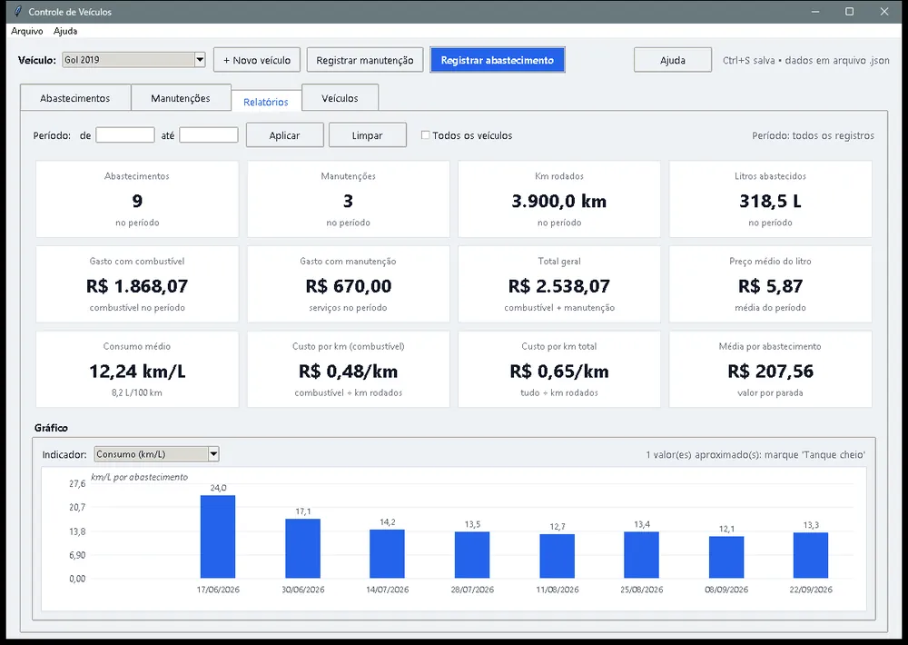
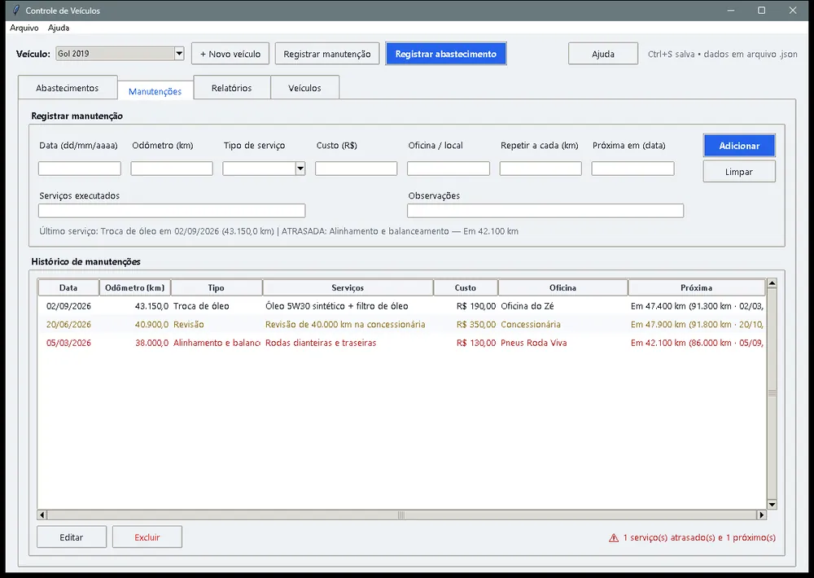

# Vehicle Cost Tracker

A Windows program to log fuel stops, record maintenance (with a reminder for the next service) and see how much a car or motorcycle really costs. It has a phone version that syncs with the PC over the home Wi-Fi, without going through the internet.

## The problem

A vehicle's real cost is scattered across fuel receipts, repair-shop invoices and notes. Without bringing it all together, you can't answer simple questions: how much does each kilometer cost? Has fuel economy gotten worse? Is the service overdue?

## What I built

- **Fuel log:** a quick form (date, odometer, liters, price per liter, station, full tank) with a history showing distance, km/L (kilometers per liter) and cost per km for each stop.
- **Maintenance:** service type, cost, shop and the next service by mileage or by date, flagged as overdue, coming up or up to date.
- **Reports:** filter by period and vehicle, 12 indicators, a chart with 5 indicators and a month-by-month summary.
- **Import** of spreadsheets (CSV, TSV or XLSX) to bring in old history.

## How fuel economy is calculated

The most important business rule is km/L. It is only exact between two full tanks:

- **km/L** = distance since the last full tank ÷ liters filled on that stretch
- **cost per km** = amount spent on the stretch ÷ distance
- Values without a full-tank reference are shown with `~` (approximate), so the user knows the number is an estimate.

## Result

| Indicator | Value |
| --- | --- |
| Indicators in the report | 12 |
| Indicators in the chart | 5 |
| Automated tests | 16 |

## Tech stack

Python with Tkinter (standard library only), data in local JSON, a phone web version served by the PC itself and a portable `.exe` for Windows 10/11. The app interface is in Portuguese.

🔗 [Official site and download (PT)](https://controle-de-veiculos.netlify.app/){:target="_blank" rel="noopener"} · [Code on GitHub](https://github.com/opusvix/controle-de-veiculos){:target="_blank" rel="noopener"}
