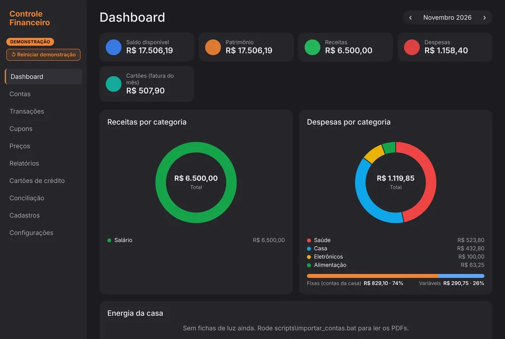
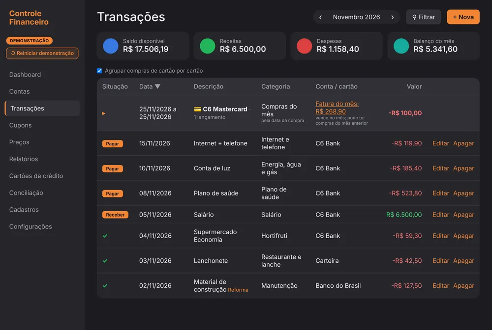

# Personal Finance Control

A family finance app: bank accounts, credit cards, transactions, line-by-line reading of grocery receipts (NFC-e, the Brazilian electronic consumer receipt) and price tracking. It runs on the user's own computer, with the data in a local file.

## The problem

Off-the-shelf apps show numbers that don't agree with each other. In the app I used before, the "Expenses" card showed **R$ 5,906.77** (Brazilian reais) while the "Expenses by category" chart, on the same screen, showed **R$ 6,084.40**. When two numbers on the same screen disagree, nobody trusts either one.

## What I built

- **Metrics dictionary:** every number in the app has a single formula, used on every screen. The category chart always adds up to the expenses card.
- **ERP-style business rules:** a receipt becomes a transaction with line items, each with a category and a product, which makes it possible to track each product's price over time.
- **Accrual basis:** the expense is the card purchase; paying the card bill only moves money between accounts, so nothing is counted twice.
- **Money stored as integer cents** (R$ 8.98 = 898), to avoid rounding errors.
- **No duplicate receipts:** the receipt's QR code identifies it (CNPJ, the Brazilian company tax ID, plus series and number) and blocks entering the same receipt twice.
- **Automatic backups** for the last 7 days, 4 weeks and 12 months, with a copy on Google Drive.

## Result

| Indicator | Value |
| --- | --- |
| Automated tests checking the rules | 140 |
| Database schema versions (SQL migrations) | 13 |
| Conflicting formulas between screens | 0 |

## Tech stack

FastAPI + SQLite backend, React + Vite + TypeScript frontend, pytest tests, packaged as a Windows `.exe` with PyWebView + PyInstaller. A demo mode uses a fictional family's data and never touches the real database.

🔗 [Code on GitHub](https://github.com/opusvix/controle-financeiro){:target="_blank" rel="noopener"} · [Full metrics dictionary (PT)](https://github.com/opusvix/controle-financeiro/blob/main/docs/METRICAS.md){:target="_blank" rel="noopener"}
