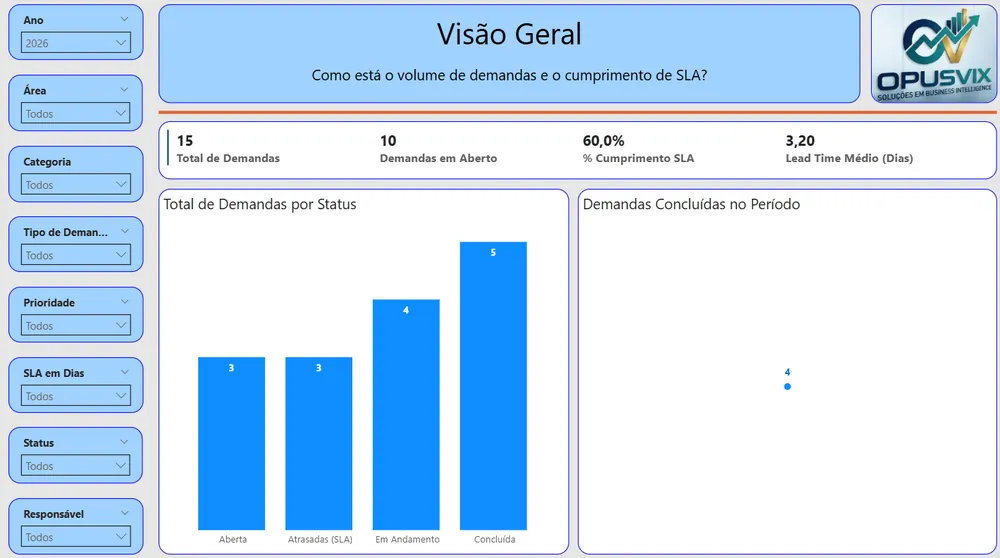
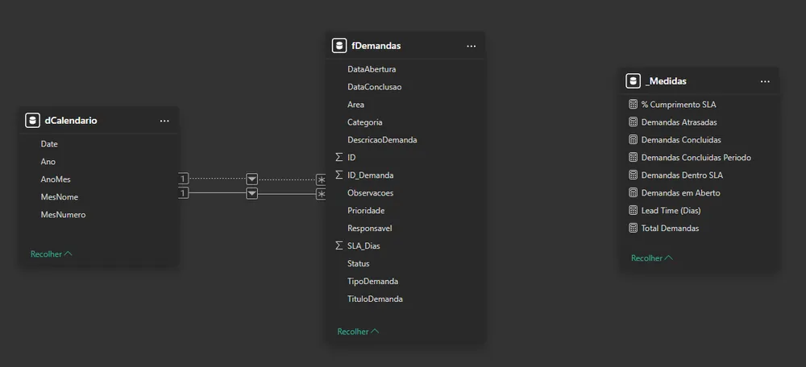
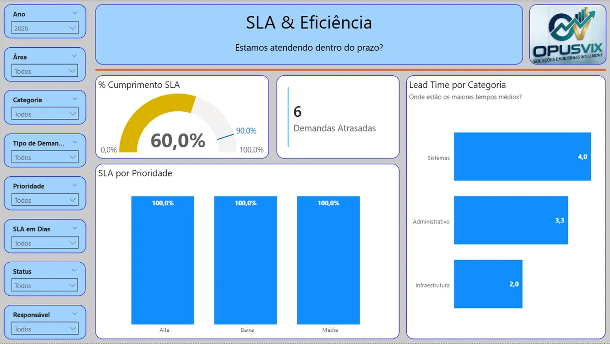

# Request Management & SLA

A Business Intelligence solution focused on data governance and SLA (service level agreement) analysis, using a SharePoint list as the source and Power BI (PBIP) as the analytics layer.

## The problem

Requests were tracked in a SharePoint list, which records each item but doesn't answer the business questions: are we meeting the agreed SLAs? Where are the bottlenecks? Which requests drag the SLA down? How is performance trending?

## What I built

- **Source:** SharePoint Online list `fDemandas`, extracted and cleaned in Power Query. Technical SharePoint columns were dropped, keeping only analytical attributes.
- **Star schema:** fact table `fDemandas` (one row per request) and a `Calendario` date table, with one-way relationships.
- **KPIs:** total requests, on time, late, SLA (%), average handling time, requests by status and by owner. DAX measures are organized in folders.
- **Executive dashboard:** SLA readability, completed vs. pending and visual highlighting of deadline misses.

## Result

| Indicator (2026) | Value |
| --- | --- |
| Total requests | 15 |
| Open requests | 10 |
| SLA compliance | 60% |
| Average lead time | 3.2 days |

At 60% compliance, 4 in 10 requests miss the deadline, and 10 of the 15 are still open. That is exactly the kind of signal the dashboard exists to surface: the next question becomes "which areas and request types concentrate the delays?". The project is built in PBIP, with the model, visuals and documentation versioned in Git, the way a corporate BI team would work.

## Tech stack

Power BI Desktop (PBIP), SharePoint Online, DAX, Power Query (M), Git and GitHub. The report interface is in Portuguese.

🔗 [Interactive dashboard](https://app.powerbi.com/view?r=eyJrIjoiNjMxMmE3NTAtYzg5NS00Yjg0LTk2MDQtZTY1MDBkYjFlYzQ1IiwidCI6ImRhM2QxODEwLThlN2YtNGM1Yy1hMzE3LTBjY2I3ZWY2MmIzYSJ9){:target="_blank" rel="noopener"} · [Code on GitHub](https://github.com/opusvix/gestao-demandas-sla-powerbi){:target="_blank" rel="noopener"}
