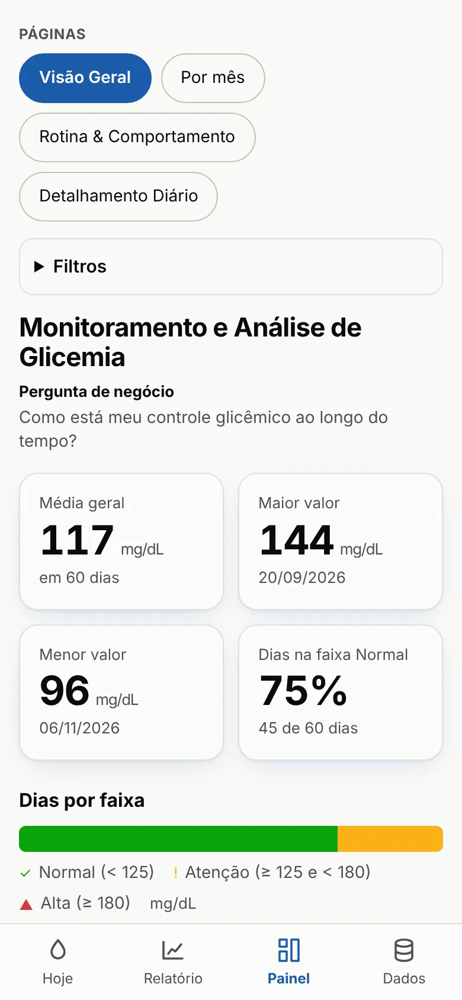
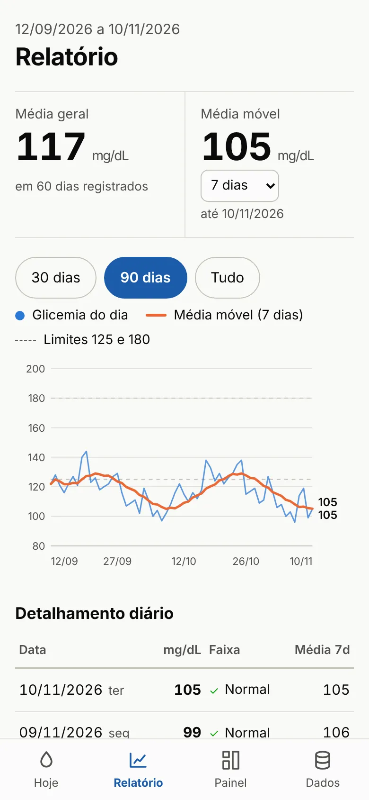

# Blood Glucose: monitoring app

An app you install on your phone (a PWA, or progressive web app) to log fasting blood glucose every day and see the indicators right away. The data stays on the device; syncing between devices is optional.

  
  

*Screens use fictional demo data. The app interface is in Portuguese.*

## The problem

Readings were logged in a spreadsheet. The analysis (in a [Power BI dashboard](/en/projetos/monitoramento-glicemia.html)) only happened every now and then, far from the moment the decision is made: the day's meals.

## What I built

I brought the dashboard's indicators into the daily log:

- **Report:** overall average, 7, 14 or 30-day moving average, a chart with the 125 and 180 mg/dL limits and a day-by-day breakdown.
- **Dashboard:** the same 4 pages as the Power BI report (Overview, By month, Routine & Behavior, Daily detail), with highest and lowest values, % of days in the normal range and weekend vs. weekday comparison.
- **Custom ranges** set by the user (normal, attention, high).
- **Import** of the spreadsheet history via CSV.

## Result

The indicator that used to require opening Power BI now shows up with every reading. One analytical model serves two audiences: the dashboard for period analysis, the app for day-to-day tracking.

## Tech stack

Plain JavaScript, PWA (service worker and manifest so it can be installed on a phone), local storage with optional sync, hosted on GitHub Pages.

🔗 [Open the app](https://opusvix.github.io/glicemia/){:target="_blank" rel="noopener"} · [Code on GitHub](https://github.com/opusvix/glicemia){:target="_blank" rel="noopener"}
