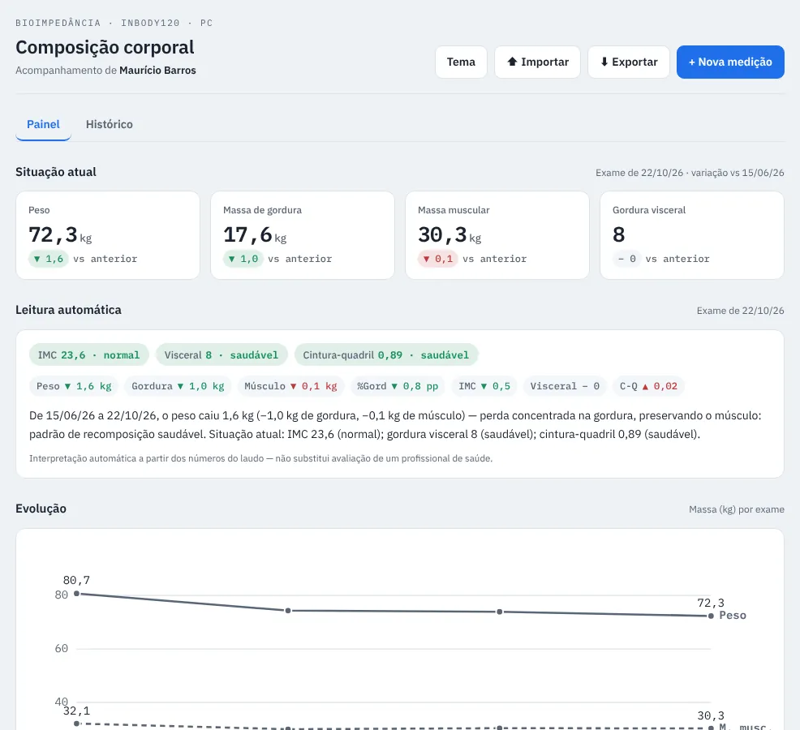

# InBody: body composition

Single-page app to track InBody120 bioimpedance scans (a body composition test that measures fat, muscle and water) over time, with a dashboard, automatic reading of the indicators, a trend chart and export.

## The problem

Each InBody120 report is one A4 sheet: a snapshot of a single moment. With the reports stored as PDFs, there was no way to answer the question that matters: did the weight drop because of fat loss or muscle loss?

## What I built

- **Data model:** each report becomes one row with 13 measures (weight, fat mass, body fat %, skeletal muscle mass, water, protein, minerals, fat-free mass, basal metabolic rate, BMI, visceral fat, waist-hip ratio and score).
- **Current status:** the 4 key indicators from the latest scan, with the change versus the previous one.
- **Automatic reading:** classifies BMI, visceral fat and waist-hip ratio against the reference ranges and writes a plain-language interpretation of the change.
- **Trend and history**, with adding and editing scans.
- **Export** to JSON, CSV and a Markdown report.

One important business rule: the report's reference ranges shift with age and weight, so the app always compares the **absolute value** between scans, never the range.

## Result (4 scans, Nov 2025 to Oct 2026)

| Indicator | 2025-11-21 | 2026-10-22 | Change |
| --- | --- | --- | --- |
| Weight (kg) | 80.7 | 72.3 | −8.4 |
| Fat mass (kg) | 22.8 | 17.6 | −5.2 |
| BMI | 26.4 | 23.6 | from overweight to normal |
| Visceral fat (level) | 10 | 8 | back within the ≤ 9 range |
| Skeletal muscle mass (kg) | 32.1 | 30.3 | −1.8 |

The series shows what a single report hides: the loss was concentrated in fat, but muscle mass dropped between Nov 2025 and Feb 2026 and only partly recovered afterwards. That is the warning sign the app highlights.

## Tech stack

HTML, CSS and JavaScript in a single file, SVG charts and data stored in the browser (`localStorage`), with no server.

🔗 [Open the app](https://opusvix.github.io/inbody/){:target="_blank" rel="noopener"} · [Code and data on GitHub](https://github.com/opusvix/inbody){:target="_blank" rel="noopener"}
