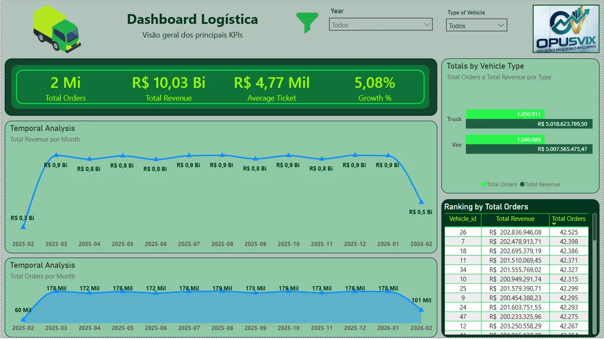
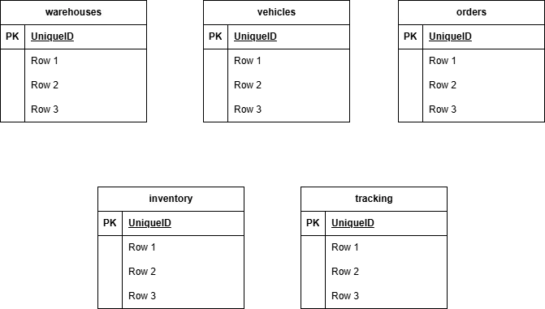

# LogiTrack SQL Analytics

A simulated logistics environment with 2.1 million rows in PostgreSQL, focused on SQL query optimization and table partitioning, with operational KPIs in Power BI.

## The problem

With millions of orders in a single table, monitoring queries slow down, and the operations dashboard lags exactly when the team needs to make a decision.

## What I built

- **Database:** PostgreSQL with 2,100,000 order rows.
- **Date partitioning:** tables split by period, so each query reads only the partitions it needs.
- **Power BI KPIs:**

| Metric | Description |
| --- | --- |
| Total Orders | Total number of orders |
| Orders by Type | Orders by vehicle type |
| Avg Delivery Time | Average delivery time |

## Result

| Scenario | Query time |
| --- | --- |
| Before (no partitioning) | 551 ms |
| After (partitioned) | 0.034 ms |

## Tech stack

PostgreSQL, SQL, Power BI and Docker.

🔗 [Code on GitHub](https://github.com/opusvix/logitrack-sql-analytics){:target="_blank" rel="noopener"}
