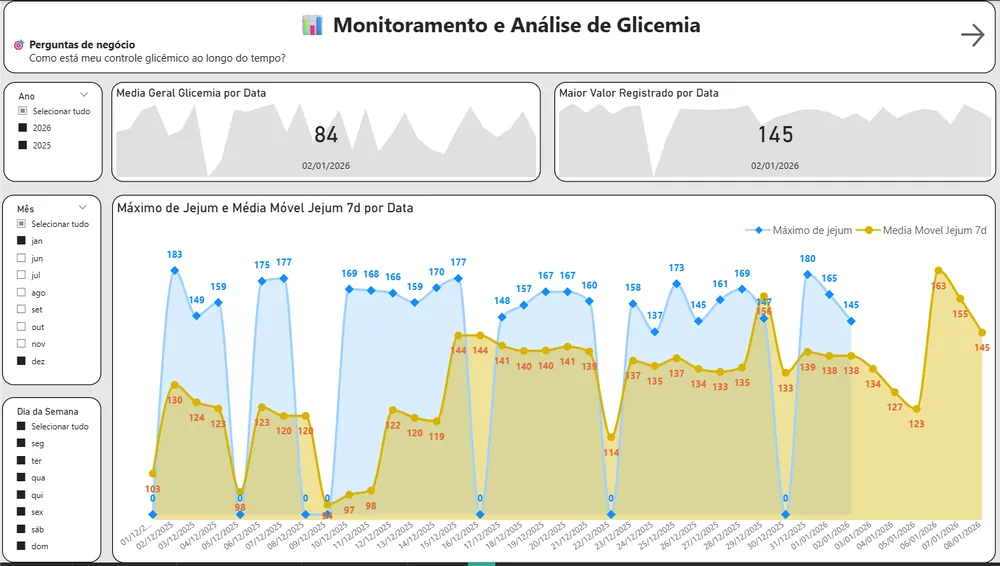
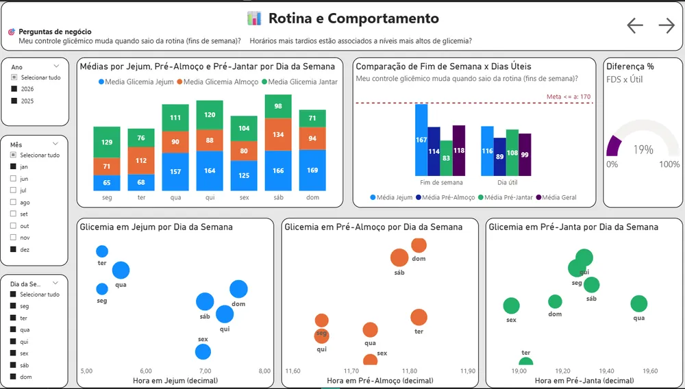

# Blood Glucose in Power BI

A Power BI dashboard that analyzes daily blood glucose readings, looking at trends over time, meal-by-meal behavior, the effect of routine and weekday vs. weekend differences.

## The problem

Readings were collected every day in an Excel sheet, but a spreadsheet doesn't show patterns: which meal causes spikes, whether weekends are worse, or whether the trend is improving.

## What I built

- **Data model:** a dedicated calendar table (`dCalendario[Date] 1 → * fGlicemia[Data]`) for time analysis, day of week, weekends and monthly and cumulative views.
- **DAX measures:** fasting average, average per meal, daily overall average, 7-day moving average, glucose range classification, weekday vs. weekend comparison and meal time analysis.
- **4 report pages:** Overview (KPIs, fasting trend, moving average), By meal (fasting, lunch and dinner, spikes), Routine & Behavior (weekday vs. weekend, time vs. glucose scatter) and Daily detail (table with conditional formatting).
- **Color legend:** 🟢 acceptable < 125 mg/dL · 🟡 attention < 180 mg/dL · 🔴 alert above 180 mg/dL.
- **PBIR format** (Power BI Project), so measures and visuals are versioned in Git.

## Result: insights

- Weekends show a higher average than weekdays.
- Later meal times tend to be associated with higher glucose levels.
- Glucose control is more stable on days with a regular routine.
- Pre-dinner glucose shows the most variability.

These findings led to the [monitoring app](/en/projetos/glicemia-app.html), which brings the same indicators into the daily log.

## Tech stack

Power BI, DAX, Excel, dimensional modeling and data storytelling. The report interface is in Portuguese. The data contains no identifying information.

🔗 [Interactive dashboard](https://app.powerbi.com/view?r=eyJrIjoiZmM0OTE1NTgtYTM0MC00MmIyLThkZmYtZmRmZmIxN2VlNGYxIiwidCI6ImRhM2QxODEwLThlN2YtNGM1Yy1hMzE3LTBjY2I3ZWY2MmIzYSJ9){:target="_blank" rel="noopener"} · [Code on GitHub](https://github.com/opusvix/glicemia-powerbi){:target="_blank" rel="noopener"}
