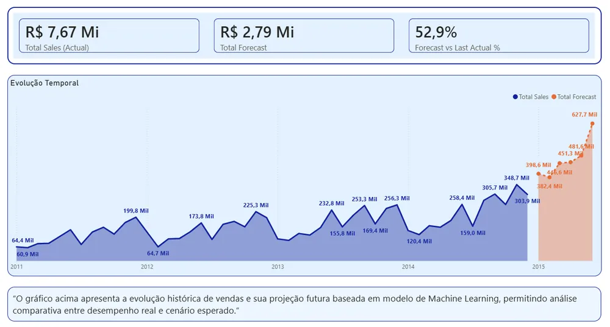
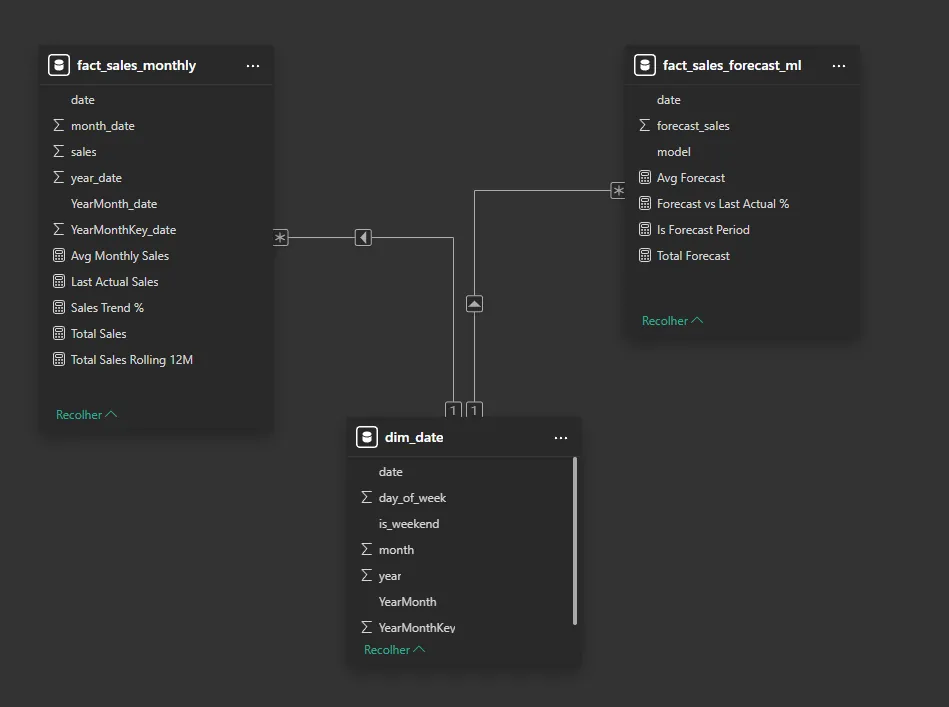

# Sales Forecast with Microsoft Fabric

An end-to-end sales forecasting project on Microsoft Fabric (Lakehouse + Warehouse), with a dimensional model in SQL and an actual vs. forecast view in Power BI.

{:target="_blank" rel="noopener"}

*Click the image to explore the interactive dashboard.*

## The problem

Companies that run on sales targets need to forecast future sales for inventory planning, target setting, revenue projection and strategic decisions. The goal was to build a modern analytics architecture that consolidates history, provides a reliable dimensional model and compares actual vs. forecast.

## What I built

**Pipeline:** Dataflow Gen2 → Lakehouse → Warehouse → SQL modeling → Power BI → GitHub Pages

- **Lakehouse:** landing zone for the raw data.
- **Warehouse:** structured layer for analytical modeling and business rules.
- **Dimensional model in SQL:**
  - `dim_date`: calendar table (date, year, month, day_of_week, is_weekend, YearMonth, YearMonthKey).
  - `fact_sales`: date, total_sales, forecast_value, linked by `fact_sales.date → dim_date.date`.
- **Forecast logic in SQL:** monthly aggregation, average/trend calculation and projection to future periods (`sql/forecast_query.sql`).
- **DAX measures:** `Total Sales = SUM(fact_sales[total_sales])` and `Total Forecast = SUM(fact_sales[forecast_value])`.

## Technical challenges solved

- Month sorting conflict on the Power BI axis, solved with a `YearMonthKey` sort key.
- Integration between Lakehouse and Warehouse.
- Date handling to keep the time series consistent.

## Result

| Indicator | Value |
| --- | --- |
| Actual sales (Total Sales) | R$ 7.67M (Brazilian reais) |
| Forecast sales (Total Forecast) | R$ 2.79M |
| Average monthly forecast vs. last actual month | +52.9% |

The **Forecast vs Last Actual %** measure = (average forecast − last actual) ÷ last actual shows the average monthly forecast sits 52.9% above the last closed month. A jump that size is what the analyst has to explain before the forecast becomes a sales target: seasonality, the historical trend or an unusual last month.

A dashboard with actual and forecast sales lines, compared month by month, on a model that can grow to forecasts by category or region.

## Tech stack

Microsoft Fabric (Dataflow Gen2, Lakehouse, Warehouse SQL endpoint), SQL, Power BI (.pbip), DAX, GitHub and GitHub Pages.

🔗 [Interactive dashboard](https://app.powerbi.com/view?r=eyJrIjoiZTRmMTBmYmYtOGE0Ny00MTc3LTk0OGItZTI3YjE2NjdjYmRiIiwidCI6ImRhM2QxODEwLThlN2YtNGM1Yy1hMzE3LTBjY2I3ZWY2MmIzYSJ9){:target="_blank" rel="noopener"} · [Project docs](https://opusvix.github.io/sales-forecast-powerbi/){:target="_blank" rel="noopener"} · [Code on GitHub](https://github.com/opusvix/sales-forecast-powerbi){:target="_blank" rel="noopener"}
