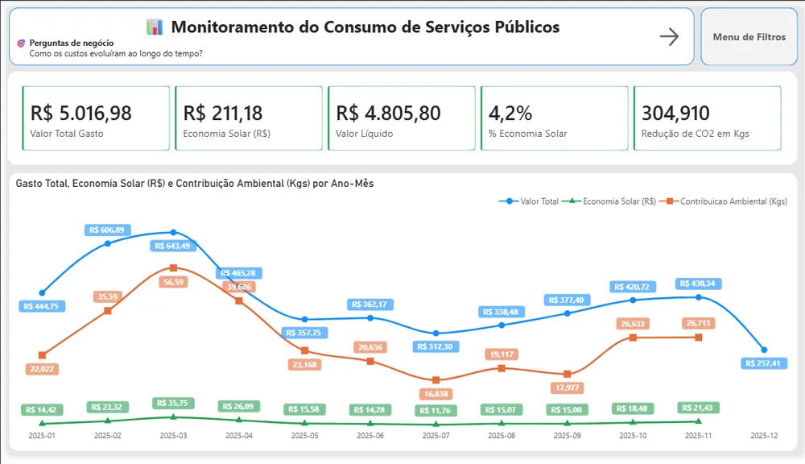
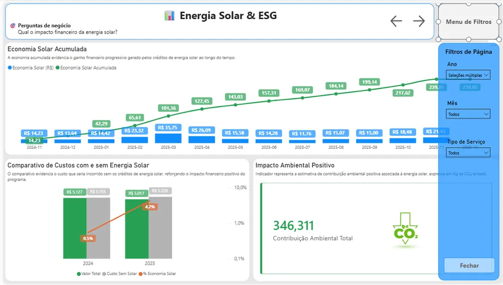

# Utilities & Solar Energy

A Power BI analysis of historical utility consumption and billing, focused on the financial impact of solar energy credits. The credits come from the Solar Digital EDP program, through a lease contract for a small solar plant (distributed mini-generation, a Brazilian scheme where off-site solar output is credited on the power bill).

## The problem

With the solar credits applied to the bill, it isn't obvious how much is actually being saved, how consumption changes across seasons or what the environmental impact is.

## What I built

- **Scope:** electricity (EDP / Escelsa, the local power utility) and water and sewage (CESAN, the state sanitation company), with monthly and yearly comparisons.
- **Star schema** with a dedicated calendar table and one-way relationships (calendar → fact).
- **DAX measures:** total consumption, total amount, gross cost, solar savings (R$, Brazilian reais), net cost, cumulative solar savings, % solar savings and total environmental contribution (kg of CO₂).
- **4 report pages:** Overview, Consumption & Efficiency (seasonal heatmap), Solar Energy & ESG (with vs. without solar) and Annual detail.

## Result

One dashboard shows how much the solar credits save each month and cumulatively, alongside consumption trends and the CO₂ avoided, to support household budgeting and efficiency decisions.

## Tech stack

Power BI Desktop (PBIP / PBIR), Power Query (M), DAX, Git and GitHub, VS Code, with OneDrive as the data source. The report interface is in Portuguese.

🔗 [Interactive dashboard](https://app.powerbi.com/view?r=eyJrIjoiN2ExYTQ2NTgtYjRiZS00NTg0LTkxODktN2RlNzU1YTAwYjRiIiwidCI6ImRhM2QxODEwLThlN2YtNGM1Yy1hMzE3LTBjY2I3ZWY2MmIzYSJ9){:target="_blank" rel="noopener"} · [Code on GitHub](https://github.com/opusvix/ServicosPublicos){:target="_blank" rel="noopener"}
