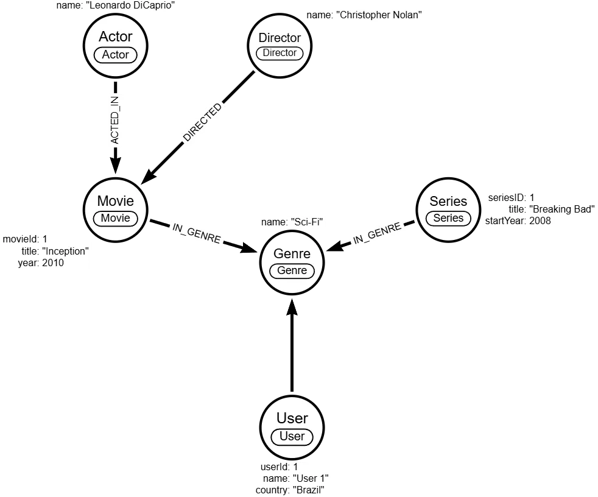

# Graph Database for Streaming (Neo4j)

A graph data model for a movie and series streaming service, built with **Neo4j** and **Cypher**, focused on **relationships** and **recommendation systems**.

## The problem

Recommendations depend on connections: users with similar taste, shared genres, actors and directors. In a relational model these questions turn into chains of joins; in a graph they are a direct walk along the relationships.

## What I built

**Nodes:** `User`, `Movie`, `Series`, `Genre`, `Actor`, `Director`.

| Relationship | Description |
| --- | --- |
| `WATCHED` | A user watched a title (has a `rating`) |
| `ACTED_IN` | An actor appeared in a movie or series |
| `DIRECTED` | A director directed a movie or series |
| `IN_GENRE` | A title belongs to a genre |

Example: `(User)-[:WATCHED {rating}]->(Movie | Series)`

**Modeling decisions:**

- Movies and series are separate entities with no direct link; similarity is inferred through genres, actors and directors.
- `WATCHED` applies to both movies and series and carries the `rating` property.
- Uniqueness constraints (`constraints.cypher`) protect the graph's integrity; the data script (`graph-data.cypher`) was generated from the diagram in Arrows.app.

## Result

A model ready for queries such as "what did users with similar taste watch?" and recommendations by genre, actor or director, with room to grow into path analysis and algorithms like PageRank.

## Tech stack

Neo4j, Cypher and Arrows.app (visual graph modeling).

🔗 [Code on GitHub](https://github.com/opusvix/streaming-graph-database){:target="_blank" rel="noopener"}
