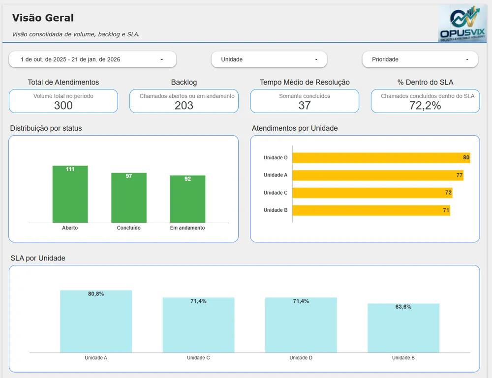
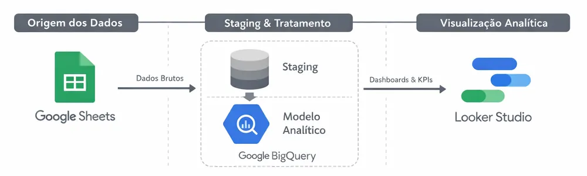

# Operations Support Monitoring

A full BI pipeline on the Google stack to monitor a simulated operations support environment: ticket volume, SLA compliance and demand trends.



## The problem

Support teams need to track ticket volume, SLA compliance and demand over time. Without an integrated view, capacity planning and prioritizing corrective actions become guesswork.

## What I built

```text
Google Sheets (simulated data)
    ↓
BigQuery (staging + analytical model)
    ↓
Looker Studio (dashboards)
```

- **Separate raw and modeled layers** in BigQuery, using standard SQL.
- **Executive overview:** total tickets, average handling time, overall SLA, and breakdown by status, unit and priority.
- **Operational analysis:** volume, handling time and SLA by unit and priority, plus a detailed ticket table.
- **Trends & planning:** demand over time, SLA trend, growth by priority and opened vs. closed.



## Result: simulated insights

- Demand grows gradually month over month.
- Units with higher volume carry a higher risk of SLA breaches.
- High-priority tickets need extra staffing.
- A growing backlog signals the need to adjust capacity.

The dashboard supports decisions on staffing by unit, SLA review by priority and future capacity planning.

## Tech stack

Google Sheets, BigQuery (standard SQL), Looker Studio and GitHub. The dashboard interface is in Portuguese.

🔗 [Interactive dashboard](https://lookerstudio.google.com/s/sD-EnJFnXEU){:target="_blank" rel="noopener"} · [Code on GitHub](https://github.com/opusvix/SuporteOperacional-StackGoogle){:target="_blank" rel="noopener"}
