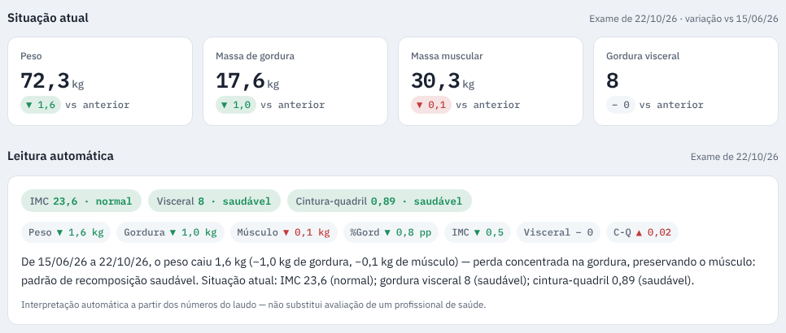
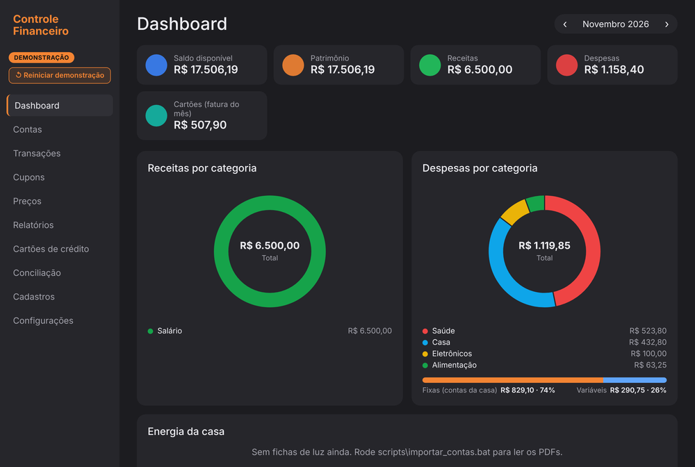
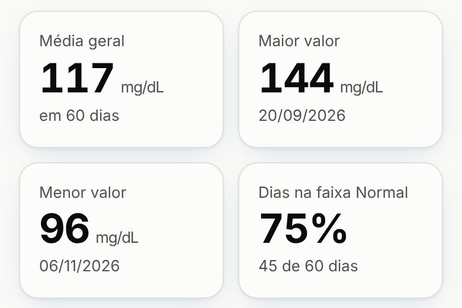
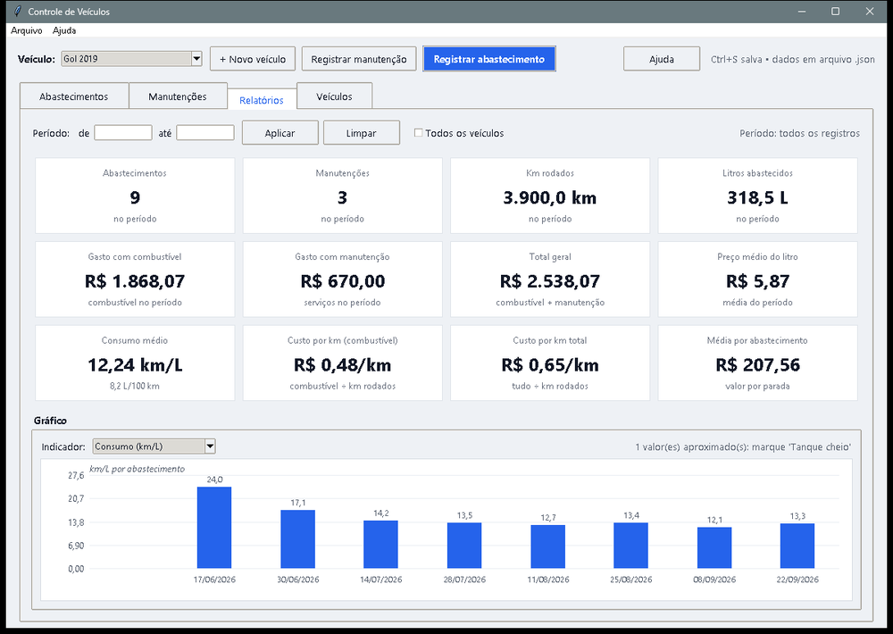

  <h1>Maurício Barros</h1>
  
Analista de Dados

  
SQL · Power BI · Python · BigQuery · Microsoft Fabric

  

    Transformo dados operacionais e financeiros em indicadores que apoiam decisões:
    do tratamento e modelagem em SQL até o dashboard e o aplicativo que entrega
    o número certo para quem decide.
  

  

    <a class="btn-primary" href="#projetos">Ver projetos</a>
    <a class="btn-secondary" href="https://drive.google.com/file/d/1SHYgzdoNEtkh31RkDU9Jj9x98bFz-7Ls/view?usp=sharing" target="_blank" rel="noopener">Baixar currículo</a>
    <a class="btn-secondary" href="#contato">Contato</a>
    <a class="btn-secondary" href="https://www.linkedin.com/in/mauriciodasilvabarros/" target="_blank" rel="noopener">LinkedIn</a>
    <a class="btn-secondary" href="https://github.com/opusvix" target="_blank" rel="noopener">GitHub</a>
  

<section id="projetos">
  <h2 class="section-title">Projetos em destaque</h2>
  
Cada projeto mostra o problema, o que construí e o resultado.

  

    <article class="card">
      
      <h3>InBody: composição corporal</h3>
      
<strong>Problema:</strong> cada laudo de bioimpedância mostra só um momento; com os PDFs espalhados, a tendência fica invisível.

      
<strong>Solução:</strong> app que transforma os laudos InBody120 em série histórica, com leitura automática contra as faixas de referência e exportação em CSV e JSON.

      
<strong>Resultado:</strong> em 4 exames, −8,4 kg de peso e −5,2 kg de gordura, com IMC de 26,4 para 23,6, e o alerta de queda de massa muscular que um laudo isolado não mostra.

      
JavaScriptAnálise temporalSaúde

      

        <a href="projetos/inbody.html">Estudo de caso</a>
        <a href="https://opusvix.github.io/inbody/" target="_blank" rel="noopener">Abrir app</a>
        <a href="https://github.com/opusvix/inbody" target="_blank" rel="noopener">GitHub</a>
      

    </article>

    <article class="card">
      
      <h3>Controle Financeiro</h3>
      
<strong>Problema:</strong> contas, cartões e compras de mercado da família espalhados, sem visão do todo.

      
<strong>Solução:</strong> app desktop que consolida contas e faturas e lê cupons fiscais (NFC-e) item a item, com controle de preços.

      
<strong>Resultado:</strong> cada indicador tem fórmula documentada num dicionário de métricas e é conferido por 140 testes automáticos.

      
PythonFastAPISQLiteReact

      

        <a href="projetos/controle-financeiro.html">Estudo de caso</a>
        <a href="https://github.com/opusvix/controle-financeiro" target="_blank" rel="noopener">GitHub</a>
      

    </article>

    <article class="card">
      
      <h3>Glicemia: app de monitoramento</h3>
      
<strong>Problema:</strong> medições diárias anotadas em planilha, sem análise no dia a dia.

      
<strong>Solução:</strong> app instalável no celular (PWA) que registra a medição e calcula os indicadores na hora, com os dados só no aparelho.

      
<strong>Resultado:</strong> média móvel de 7, 14 ou 30 dias, % de dias na faixa normal e comparação fim de semana × dias úteis a cada registro.

      
JavaScriptPWAAnálise temporal

      

        <a href="projetos/glicemia-app.html">Estudo de caso</a>
        <a href="https://opusvix.github.io/glicemia/" target="_blank" rel="noopener">Abrir app</a>
        <a href="https://github.com/opusvix/glicemia" target="_blank" rel="noopener">GitHub</a>
      

    </article>

    <article class="card">
      
      <h3>Controle de Veículos</h3>
      
<strong>Problema:</strong> o custo real do carro fica espalhado entre notas de posto e oficina.

      
<strong>Solução:</strong> app Windows com versão para celular e sincronização pelo Wi-Fi, para abastecimentos, manutenções e lembretes de revisão.

      
<strong>Resultado:</strong> 12 indicadores por período e veículo, incluindo km/L e R$/km de cada abastecimento.

      
PythonTkinterIndicadores

      

        <a href="projetos/controle-de-veiculos.html">Estudo de caso</a>
        <a href="https://controle-de-veiculos.netlify.app/" target="_blank" rel="noopener">Site</a>
        <a href="https://github.com/opusvix/controle-de-veiculos" target="_blank" rel="noopener">GitHub</a>
      

    </article>

    <article class="card">
      
      <h3>Porsche Enterprise Sales Intelligence</h3>
      
<strong>Problema:</strong> a diretoria precisa comparar vendas entre períodos e chegar até a transação.

      
<strong>Solução:</strong> dashboard executivo com KPIs, comparação temporal, drill-through e detalhamento transacional.

      
<strong>Resultado:</strong> tratamento de qualidade que separa os 76 de 100 registros com data válida, para que a evolução mensal não seja distorcida.

      
Projeto de estudo, sem afiliação com a Porsche.

      
ReactTypeScriptQualidade de dados

      

        <a href="https://porsche-sales-intelligence.opusvix.chatgpt.site" target="_blank" rel="noopener">Dashboard</a>
        <a href="https://github.com/opusvix/dashboard_porsche_sales" target="_blank" rel="noopener">GitHub</a>
      

    </article>

    <article class="card">
      
      <h3>LogiTrack: SQL Analytics</h3>
      
<strong>Problema:</strong> consultas lentas numa base logística de 2,1 milhões de registros.

      
<strong>Solução:</strong> particionamento das tabelas por data no PostgreSQL e KPIs operacionais no Power BI.

      
<strong>Resultado:</strong> a consulta caiu de 551 ms para 0,034 ms.

      
PostgreSQLSQLPower BIDocker

      

        <a href="projetos/logitrack-sql-analytics.html">Estudo de caso</a>
        <a href="https://app.powerbi.com/view?r=eyJrIjoiZDk5NzgyMWItN2EwOS00NzA0LTgzMDYtNmI3NmJjZmNmZDMyIiwidCI6ImRhM2QxODEwLThlN2YtNGM1Yy1hMzE3LTBjY2I3ZWY2MmIzYSJ9" target="_blank" rel="noopener">Dashboard</a>
        <a href="https://github.com/opusvix/logitrack-sql-analytics" target="_blank" rel="noopener">GitHub</a>
      

    </article>

  

</section>

<section id="outros">
  <h2 class="section-title">Outros projetos</h2>

  

    <article class="card card-small">
      <h3>Previsão de Vendas com Microsoft Fabric</h3>
      
Pipeline Dataflow Gen2 → Lakehouse → Warehouse, forecast em SQL e realizado × previsto no Power BI.

      
Microsoft FabricSQLPower BI

      

        <a href="projetos/sales-forecast-ml.html">Estudo de caso</a>
        <a href="https://app.powerbi.com/view?r=eyJrIjoiZTRmMTBmYmYtOGE0Ny00MTc3LTk0OGItZTI3YjE2NjdjYmRiIiwidCI6ImRhM2QxODEwLThlN2YtNGM1Yy1hMzE3LTBjY2I3ZWY2MmIzYSJ9" target="_blank" rel="noopener">Dashboard</a>
        <a href="https://github.com/opusvix/sales-forecast-powerbi" target="_blank" rel="noopener">GitHub</a>
      

    </article>

    <article class="card card-small">
      <h3>Glicemia no Power BI</h3>
      
Padrões por refeição, rotina e dia da semana em 4 páginas, com tabela calendário e média móvel em DAX.

      
Power BIDAXPBIP

      

        <a href="projetos/monitoramento-glicemia.html">Estudo de caso</a>
        <a href="https://app.powerbi.com/view?r=eyJrIjoiZmM0OTE1NTgtYTM0MC00MmIyLThkZmYtZmRmZmIxN2VlNGYxIiwidCI6ImRhM2QxODEwLThlN2YtNGM1Yy1hMzE3LTBjY2I3ZWY2MmIzYSJ9" target="_blank" rel="noopener">Dashboard</a>
        <a href="https://github.com/opusvix/glicemia-powerbi" target="_blank" rel="noopener">GitHub</a>
      

    </article>

    <article class="card card-small">
      <h3>Serviços Públicos &amp; Energia Solar</h3>
      
Custo de energia e saneamento com e sem os créditos de energia solar, economia acumulada e CO₂ evitado.

      
Power BIDAXESG

      

        <a href="projetos/servicos-publicos-energia.html">Estudo de caso</a>
        <a href="https://app.powerbi.com/view?r=eyJrIjoiN2ExYTQ2NTgtYjRiZS00NTg0LTkxODktN2RlNzU1YTAwYjRiIiwidCI6ImRhM2QxODEwLThlN2YtNGM1Yy1hMzE3LTBjY2I3ZWY2MmIzYSJ9" target="_blank" rel="noopener">Dashboard</a>
        <a href="https://github.com/opusvix/ServicosPublicos" target="_blank" rel="noopener">GitHub</a>
      

    </article>

    <article class="card card-small">
      <h3>Gestão de Demandas &amp; SLA</h3>
      
SLA, backlog e produtividade por responsável, com SharePoint como fonte e modelo em estrela.

      
Power BISharePoint

      

        <a href="projetos/gestao-demandas-sla.html">Estudo de caso</a>
        <a href="https://app.powerbi.com/view?r=eyJrIjoiNjMxMmE3NTAtYzg5NS00Yjg0LTk2MDQtZTY1MDBkYjFlYzQ1IiwidCI6ImRhM2QxODEwLThlN2YtNGM1Yy1hMzE3LTBjY2I3ZWY2MmIzYSJ9" target="_blank" rel="noopener">Dashboard</a>
        <a href="https://github.com/opusvix/gestao-demandas-sla-powerbi" target="_blank" rel="noopener">GitHub</a>
      

    </article>

    <article class="card card-small">
      <h3>Suporte Operacional (stack Google)</h3>
      
Pipeline Google Sheets → BigQuery → Looker Studio com SLA, volume, backlog e tendências.

      
BigQueryLooker StudioGCP

      

        <a href="projetos/suporte-operacional-google.html">Estudo de caso</a>
        <a href="https://lookerstudio.google.com/s/sD-EnJFnXEU" target="_blank" rel="noopener">Dashboard</a>
        <a href="https://github.com/opusvix/SuporteOperacional-StackGoogle" target="_blank" rel="noopener">GitHub</a>
      

    </article>

    <article class="card card-small">
      <h3>Banco de grafos para streaming</h3>
      
Modelo de usuários, filmes, séries, gêneros e atores em Neo4j para consultas de recomendação.

      
Neo4jCypher

      

        <a href="projetos/streaming-graph-neo4j.html">Estudo de caso</a>
        <a href="https://github.com/opusvix/streaming-graph-database" target="_blank" rel="noopener">GitHub</a>
      

    </article>

  

</section>

<section id="sobre">
  <h2 class="section-title">Sobre</h2>
  

    Sou Analista de Dados formado em Banco de Dados. Trabalho com o ciclo completo
    da análise: entender a pergunta de negócio, tratar e modelar os dados em SQL,
    definir os indicadores e entregar a resposta em dashboard ou aplicativo.
    Versiono meus relatórios Power BI em Git (PBIP/PBIR) e documento a fórmula de cada métrica.
  

  

    

      <h3>Competências</h3>
      <ul>
        <li>Análise exploratória e qualidade de dados</li>
        <li>SQL e modelagem dimensional</li>
        <li>Dashboards executivos e storytelling com dados</li>
        <li>Automação de processos analíticos</li>
      </ul>
    

    

      <h3>Ferramentas</h3>
      <ul>
        <li>SQL (PostgreSQL, BigQuery, SQLite)</li>
        <li>Power BI, DAX, Looker Studio</li>
        <li>Python, Microsoft Fabric</li>
        <li>Git, GitHub, Docker</li>
      </ul>
    

  

</section>

<section id="contato">
  <h2 class="section-title">Contato</h2>
  
Estou aberto a vagas de Analista de Dados. Fale comigo:

  <ul class="contact-list">
    <li>E-mail: <a href="mailto:mauriciobarros1957@gmail.com">mauriciobarros1957@gmail.com</a></li>
    <li><a href="https://www.linkedin.com/in/mauriciodasilvabarros/" target="_blank" rel="noopener">LinkedIn</a></li>
    <li><a href="https://github.com/opusvix" target="_blank" rel="noopener">GitHub</a></li>
    <li><a href="https://drive.google.com/file/d/1SHYgzdoNEtkh31RkDU9Jj9x98bFz-7Ls/view?usp=sharing" target="_blank" rel="noopener">Currículo (PDF)</a></li>
  </ul>
</section>
