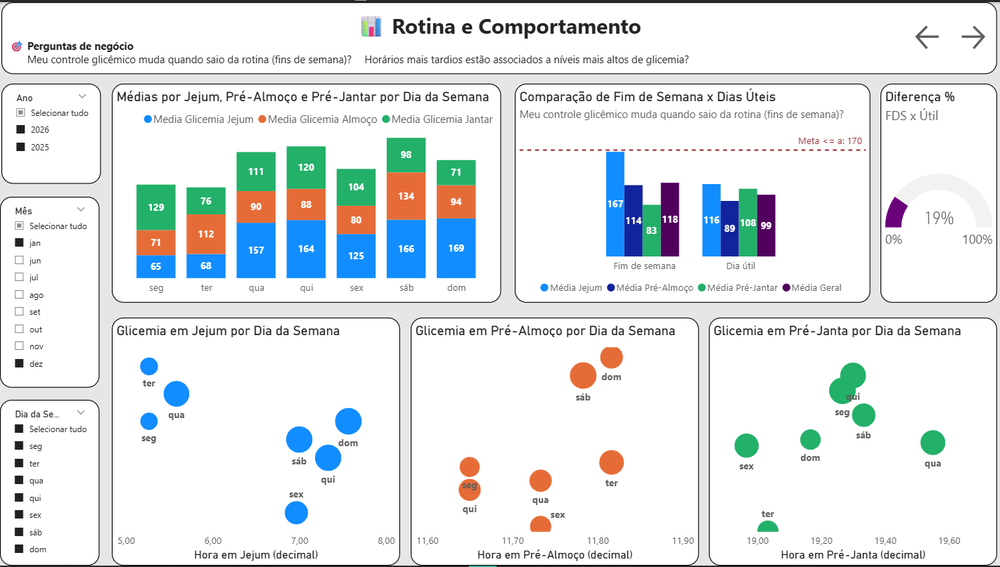
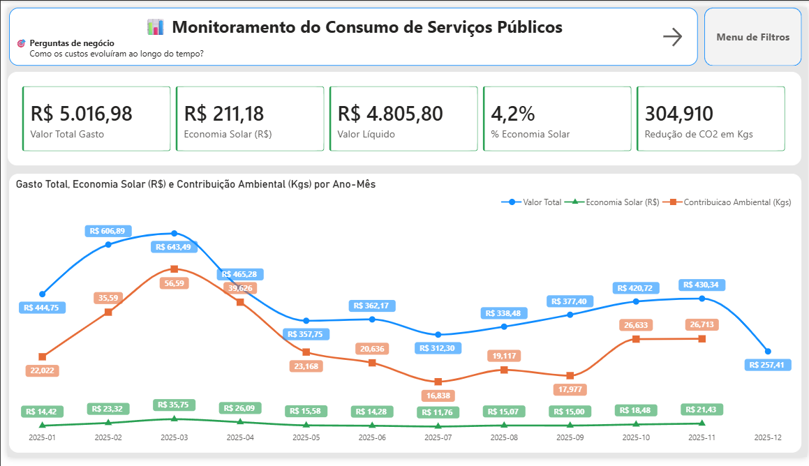
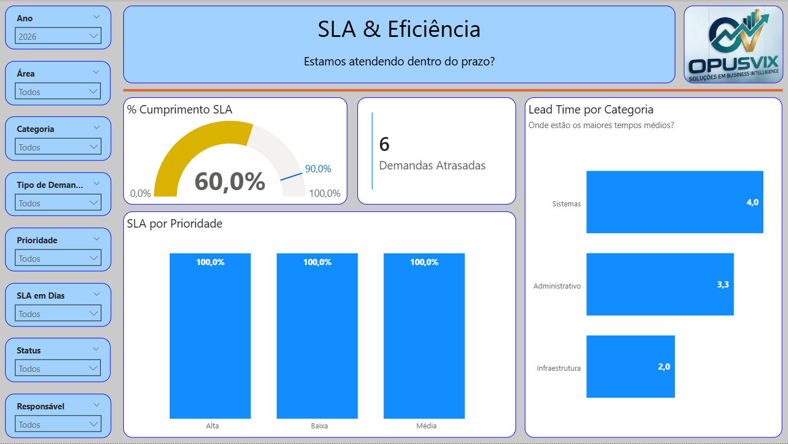
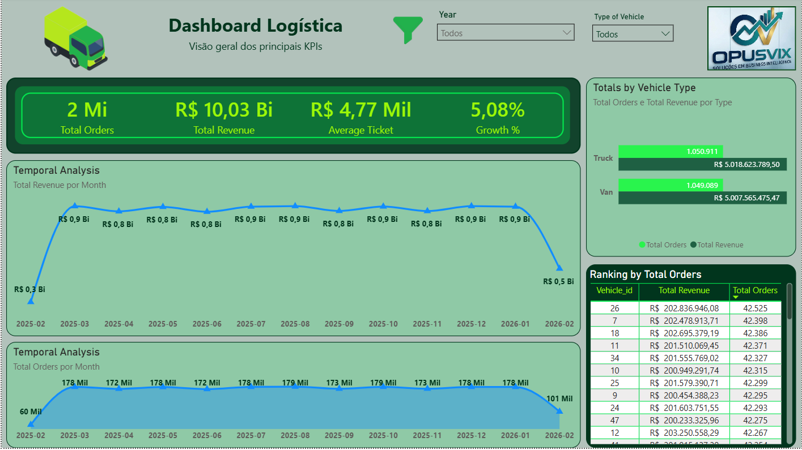

  <h1>Maurício Barros</h1>
  <h2>Analista de Dados focado em BI, Analytics e Tomada de Decisão</h2>
  <h2>Power BI • SQL • BigQuery • Modelagem Analítica • Dashboards Executivos</h2>

  

    Analista de Dados formado em Banco de Dados, com foco em
    <strong>Business Intelligence, Analytics e Engenharia de Dados</strong>.
    Desenvolvo dashboards, pipelines analíticos e modelos de dados
    que transformam dados em decisões de negócio.
  

  

    <a class="btn-primary" href="#projetos">Projetos</a>
    <a class="btn-secondary" href="#contato">Contato</a>
    <a class="btn-secondary" href="https://github.com/opusvix" target="_blank" rel="noopener">GitHub</a>
    <a class="btn-secondary" href="https://www.linkedin.com/in/mauriciodasilvabarros/" target="_blank" rel="noopener">LinkedIn</a>
  

---

<section id="projetos">
  <h2 class="section-title">Projetos em Destaque</h2>

  

   

      
      <h3>🏎️ Porsche Enterprise Sales Intelligence</h3>
      

        Dashboard executivo de vendas Porsche com KPIs, comparação temporal, drill-through, insights e detalhamento transacional.
      

      

        React
        TypeScript
        Analytics
      

      

        <a
          href="https://github.com/opusvix/dashboard_porsche_sales"
          target="_blank" rel="noopener"
        >
          GitHub
        </a>
        <a
          href="https://porsche-sales-intelligence.opusvix.chatgpt.site"
          target="_blank" rel="noopener"
        >
          Dashboard
        </a>
      

    

    <!-- Monitoramento e Análise de Glicemia -->
   

      
      <h3>📊 Monitoramento e Análise de Glicemia</h3>
      

        Análise e visualização de indicadores glicêmicos para acompanhamento
        contínuo e apoio à tomada de decisão em saúde.
      

      

        Power BI
        PBIP
        Analytics
      

      

        <a
          href="https://github.com/opusvix/glicemia-powerbi"
          target="_blank" rel="noopener"
        >
          GitHub
        </a>
        <a
          href="https://app.powerbi.com/view?r=eyJrIjoiZmM0OTE1NTgtYTM0MC00MmIyLThkZmYtZmRmZmIxN2VlNGYxIiwidCI6ImRhM2QxODEwLThlN2YtNGM1Yy1hMzE3LTBjY2I3ZWY2MmIzYSJ9"
          target="_blank" rel="noopener"
        >
          Dashboard
        </a>
      

    

    <!-- Serviços Públicos e Energia Solar -->
   

      
      <h3>⚡ Serviços Públicos &amp; Energia Solar</h3>
      

        Análise de consumo energético e economia financeira com foco em
        eficiência operacional e redução de custos.
      

      

        Power BI
        DAX
        PBIP
      

      

        <a
          href="https://github.com/opusvix/ServicosPublicos"
          target="_blank" rel="noopener"
        >
          GitHub
        </a>
        <a
          href="https://app.powerbi.com/view?r=eyJrIjoiN2ExYTQ2NTgtYjRiZS00NTg0LTkxODktN2RlNzU1YTAwYjRiIiwidCI6ImRhM2QxODEwLThlN2YtNGM1Yy1hMzE3LTBjY2I3ZWY2MmIzYSJ9"
          target="_blank" rel="noopener"
        >
          Dashboard
        </a>
      

    

    <!-- Gestão de Demandas e SLA -->
   

      
      <h3>📈 Gestão de Demandas &amp; SLA</h3>
      

        Monitoramento de SLAs, produtividade e desempenho operacional para
        suporte à gestão de serviços.
      

      

        Power BI
        SharePoint
      

      

        <a
          href="https://github.com/opusvix/gestao-demandas-sla-powerbi"
          target="_blank" rel="noopener"
        >
          GitHub
        </a>
        <a
          href="https://app.powerbi.com/view?r=eyJrIjoiNjMxMmE3NTAtYzg5NS00Yjg0LTk2MDQtZTY1MDBkYjFlYzQ1IiwidCI6ImRhM2QxODEwLThlN2YtNGM1Yy1hMzE3LTBjY2I3ZWY2MmIzYSJ9"
          target="_blank" rel="noopener"
        >
          Dashboard
        </a>
      

    

    <!-- Suporte Operacional -->
   

      <h3>🧠 Suporte Operacional (Stack Google)</h3>
      

        Pipeline analítico em stack Google para monitoramento operacional e
        visualização de indicadores em tempo quase real.
      

      

        BigQuery
        Looker
        GCP
      

      

        <a
          href="https://github.com/opusvix/SuporteOperacional-StackGoogle"
          target="_blank" rel="noopener"
        >
          GitHub
        </a>
        <a
          href="https://lookerstudio.google.com/s/sD-EnJFnXEU"
          target="_blank" rel="noopener"
        >
          Dashboard
        </a>
      

    

    <!-- Streaming Graph Database -->
   

      <h3>🕸️ Streaming Graph Database (Neo4j)</h3>
      

        Modelagem de dados em grafos para sistemas de recomendação, explorando
        relacionamentos e consultas em Cypher.
      

      

        Neo4j
        Cypher
      

      

        <a
          href="https://github.com/opusvix/streaming-graph-database"
          target="_blank" rel="noopener"
        >
          GitHub
        </a>
      

    

    <!-- Sales Forecast -->
   

      <h3>📊 Sales Forecast | Machine Learning</h3>
      

        Previsão de vendas com Microsoft Fabric integrada a Warehouse e
        Power BI.
      

      

        Fabric
        Power BI
      

      

        <a
          href="https://github.com/opusvix/sales-forecast-powerbi"
          target="_blank" rel="noopener"
        >
          GitHub
        </a>
        <a
          href="https://app.powerbi.com/view?r=eyJrIjoiZTRmMTBmYmYtOGE0Ny00MTc3LTk0OGItZTI3YjE2NjdjYmRiIiwidCI6ImRhM2QxODEwLThlN2YtNGM1Yy1hMzE3LTBjY2I3ZWY2MmIzYSJ9"
          target="_blank" rel="noopener"
        >
          Dashboard
        </a>
      

    

    <!-- Análise Logística -->
   

      
      <h3>📊 Análise Logística</h3>
      

        Projeto de Análise Logística com SQL Avançado, KPIs operacionais e
        modelagem analítica.
      

      

        Power BI
        SQL
        Docker
      

      

        <a
          href="https://github.com/opusvix/logitrack-sql-analytics"
          target="_blank" rel="noopener"
        >
          GitHub
        </a>
        <a
          href="https://app.powerbi.com/view?r=eyJrIjoiZDk5NzgyMWItN2EwOS00NzA0LTgzMDYtNmI3NmJjZmNmZDMyIiwidCI6ImRhM2QxODEwLThlN2YtNGM1Yy1hMzE3LTBjY2I3ZWY2MmIzYSJ9"
          target="_blank" rel="noopener"
        >
          Dashboard
        </a>
      

    

  

</section>

---

## 🧠 Stack de Tecnologias
    
   - Python · SQL · Power BI · BigQuery · Looker Studio · GitHub · GCP · Fabric · Docker

## 🧠 Competências

- Análise Exploratória de Dados (EDA)

- SQL e Modelagem de Dados

- BI e Dashboards Executivos

- Automação de Processos Analíticos

- Storytelling com Dados   
 
## 🔗 Portfólio Técnico Completo
    
👉 Para detalhes técnicos, arquitetura, modelagem e código:
    
🔎 **GitHub:** [github.com/opusvix](https://github.com/opusvix){:target="_blank" rel="noopener"}
        
## 👤 Contato {#contato}    
  Maurício Barros    
  Analista de Dados  
  
  💼 [LinkedIn](https://www.linkedin.com/in/mauriciodasilvabarros/){:target="_blank" rel="noopener"}
  
  🧑‍💻 [GitHub](https://github.com/opusvix){:target="_blank" rel="noopener"}

"Dados bem analisados contam histórias melhores do que achismos."

