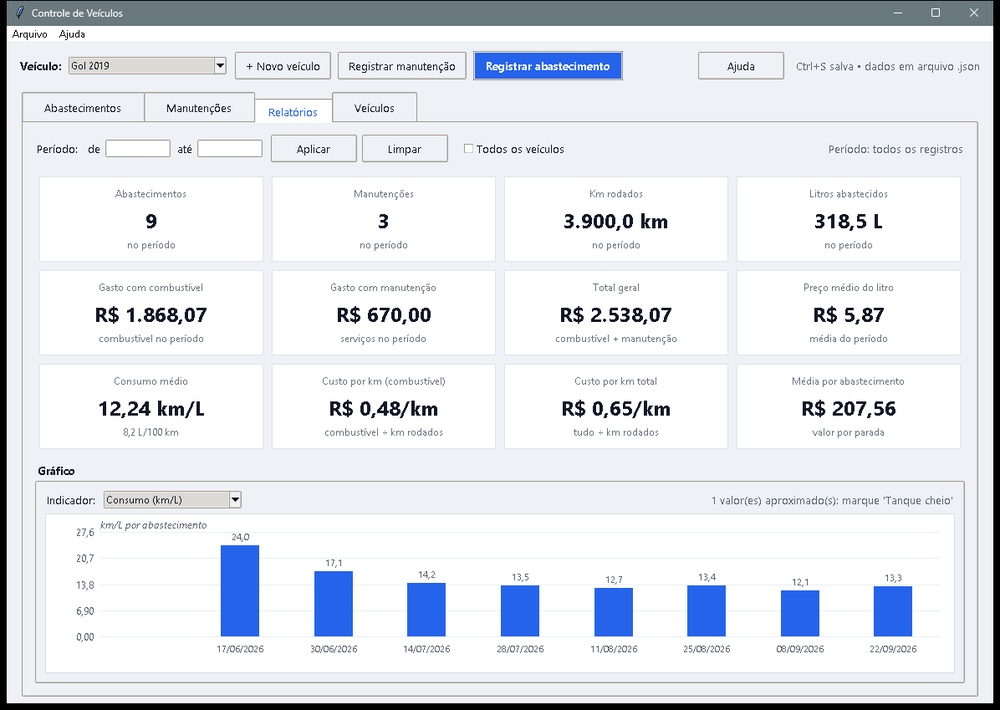
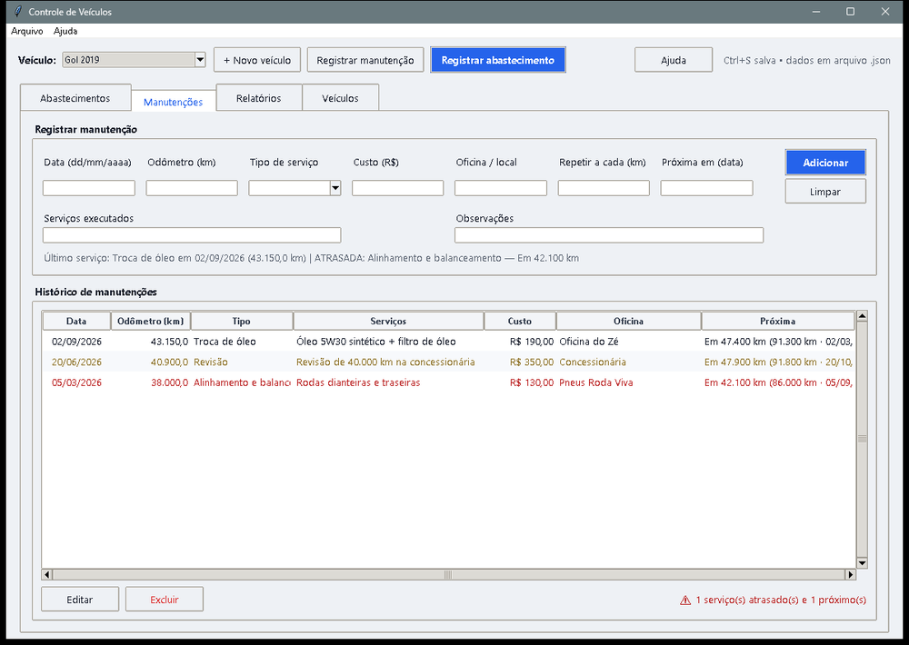

# Controle de Veículos

Programa de Windows para registrar abastecimentos, lançar manutenções (com lembrete da próxima revisão) e ver quanto o carro ou a moto está custando. Tem versão para celular, que sincroniza com o PC pela rede Wi-Fi da casa, sem passar pela internet.

## O problema

O custo real de um veículo fica espalhado entre notas de posto, recibos de oficina e anotações. Sem juntar tudo, não dá para responder perguntas simples: quanto custa cada quilômetro rodado? O consumo piorou? A revisão está atrasada?

## O que construí

- **Abastecimentos:** formulário rápido (data, odômetro, litros, preço por litro, posto, tanque cheio) com histórico que mostra distância, km/L e R$/km de cada parada.
- **Manutenções:** tipo de serviço, custo, oficina e a próxima manutenção por km ou por data, com aviso de atrasada, próxima ou em dia.
- **Relatórios:** filtro por período e por veículo, 12 indicadores, gráfico com 5 indicadores e resumo mês a mês.
- **Importação** de planilhas (CSV, TSV ou XLSX) para trazer o histórico antigo.

## Como o consumo é calculado

A regra de negócio mais importante é a do km/L. Ele só é exato entre dois tanques cheios:

- **km/L** = distância desde o último tanque cheio ÷ litros abastecidos nesse trecho
- **R$/km** = valor gasto no trecho ÷ distância
- Valores sem referência de tanque cheio aparecem com `~` (aproximados), para o usuário saber que o número é uma estimativa.

## Resultado

| Indicador | Valor |
| --- | --- |
| Indicadores no relatório | 12 |
| Indicadores no gráfico | 5 |
| Testes automáticos | 16 |

## Tecnologias

Python com Tkinter (só a biblioteca padrão), dados em JSON local, versão web para celular servida pelo próprio PC e `.exe` portátil para Windows 10/11.

🔗 [Site oficial e download](https://controle-de-veiculos.netlify.app/){:target="_blank" rel="noopener"} · [Código no GitHub](https://github.com/opusvix/controle-de-veiculos){:target="_blank" rel="noopener"}

[← Voltar ao portfólio](/#projetos){: .back-home}
