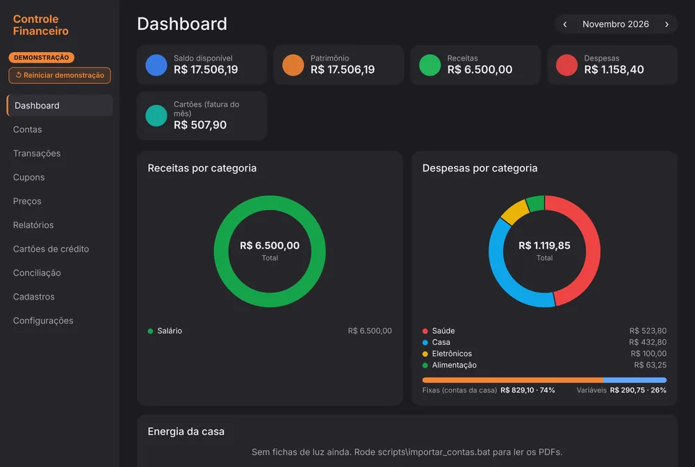
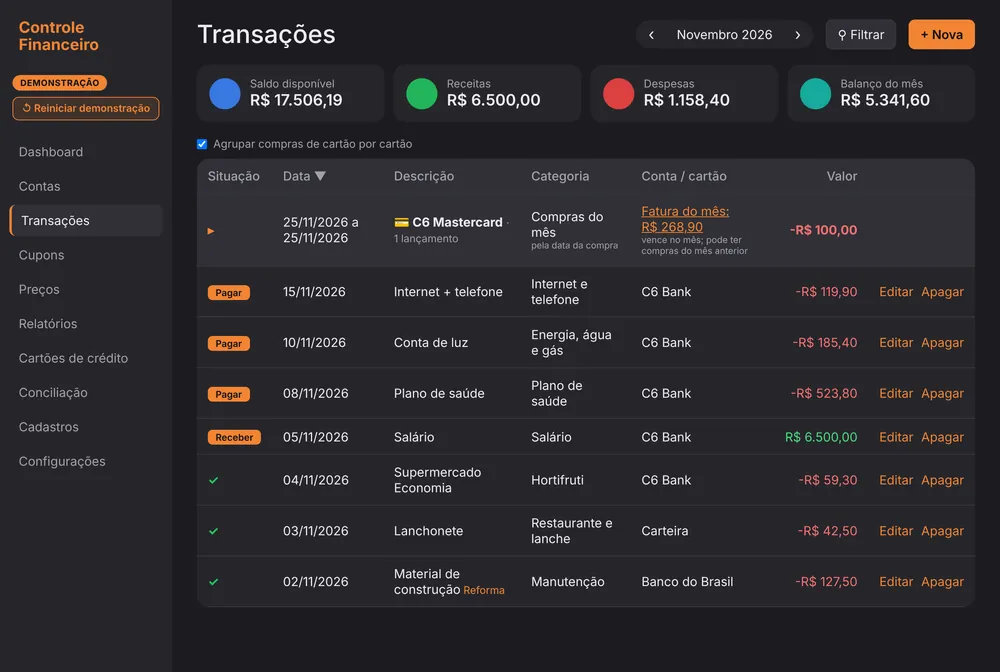

# Controle Financeiro

App de finanças pessoais da família: contas, cartões de crédito, transações, leitura de cupons fiscais (NFC-e) item a item e controle de preços. Roda no próprio computador, com os dados num arquivo local.

## O problema

Apps de mercado mostram números que não batem entre si. No app que eu usava antes, o card "Despesas" mostrava **R$ 5.906,77** e o gráfico "Despesas por categoria", na mesma tela, **R$ 6.084,40**. Quando dois números da mesma tela divergem, ninguém confia em nenhum dos dois.

## O que construí

- **Dicionário de métricas:** cada número do app tem uma única fórmula, usada em todas as telas. A soma do gráfico por categoria é sempre igual ao card de despesas.
- **Regras de negócio de ERP:** um cupom fiscal vira uma transação com itens, cada item com categoria e produto, o que permite acompanhar o preço de cada produto ao longo do tempo.
- **Regime de competência:** a despesa é a compra no cartão; o pagamento da fatura só movimenta a conta, então nada é contado em dobro.
- **Dinheiro em centavos inteiros** (R$ 8,98 = 898), para evitar erro de arredondamento.
- **NFC-e sem duplicidade:** o QR Code identifica a nota (CNPJ, série, número) e impede lançar a mesma nota duas vezes.
- **Backup automático** dos últimos 7 dias, 4 semanas e 12 meses, com cópia no Google Drive.

## Resultado

| Indicador | Valor |
| --- | --- |
| Testes automáticos que conferem as regras | 140 |
| Versões do esquema do banco (migrações SQL) | 13 |
| Fórmulas divergentes entre telas | 0 |

## Tecnologias

Backend FastAPI + SQLite, frontend React + Vite + TypeScript, testes com pytest e empacotamento como `.exe` com PyWebView + PyInstaller. Há um modo demonstração com dados de uma família fictícia, que nunca toca o banco real.

🔗 [Código no GitHub](https://github.com/opusvix/controle-financeiro){:target="_blank" rel="noopener"} · [Dicionário de métricas completo](https://github.com/opusvix/controle-financeiro/blob/main/docs/METRICAS.md){:target="_blank" rel="noopener"}

