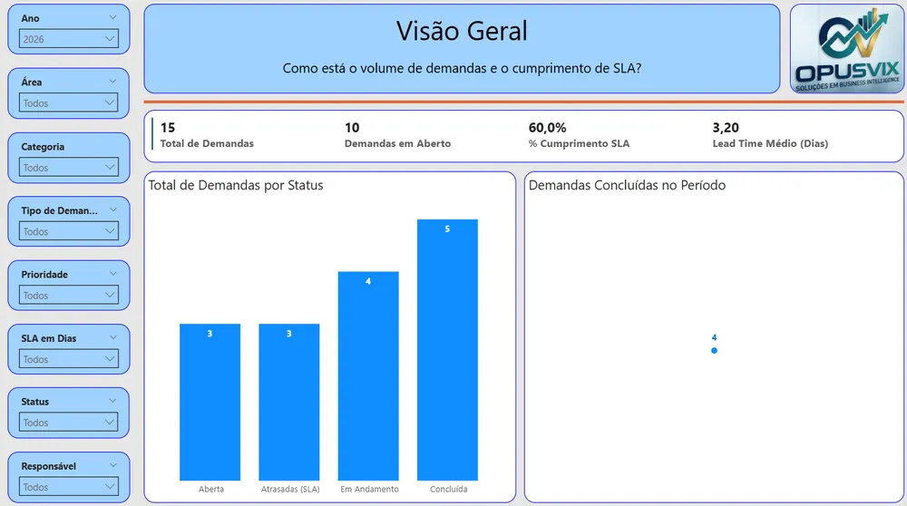
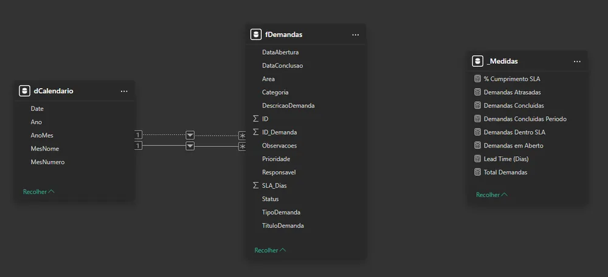
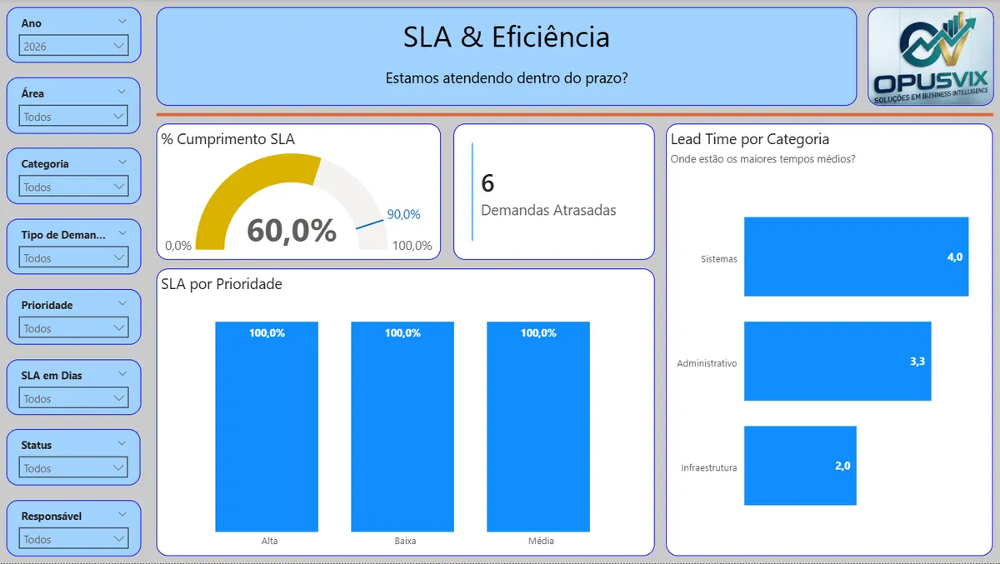

# Gestão de Demandas & SLA

Solução de Business Intelligence com foco em governança de dados e análise de SLA (acordo de nível de serviço), usando uma lista do SharePoint como fonte e o Power BI (PBIP) como camada analítica.

## O problema

As demandas eram registradas numa lista do SharePoint, que guarda cada item mas não responde às perguntas de negócio: estamos cumprindo os SLAs acordados? Onde estão os gargalos? Quais demandas puxam o SLA para baixo? Como o desempenho evolui?

## O que construí

- **Fonte:** lista `fDemandas` do SharePoint Online, extraída e tratada no Power Query. As colunas técnicas do SharePoint foram descartadas, ficando só os atributos analíticos.
- **Modelo em estrela:** tabela fato `fDemandas` (uma linha por demanda) e dimensão `Calendario`, com relacionamentos unidirecionais.
- **KPIs:** total de demandas, no prazo, fora do prazo, SLA (%), tempo médio de atendimento, demandas por status e por responsável. As medidas DAX estão organizadas em pastas.
- **Dashboard executivo:** leitura clara do SLA, concluídas × pendentes e destaque visual para os desvios de prazo.

## Resultado

Um dashboard que responde às quatro perguntas de negócio acima, construído em PBIP para que modelo, visuais e documentação fiquem versionados em Git, como num time de BI corporativo.

## Tecnologias

Power BI Desktop (PBIP), SharePoint Online, DAX, Power Query (M), Git e GitHub.

🔗 [Dashboard interativo](https://app.powerbi.com/view?r=eyJrIjoiNjMxMmE3NTAtYzg5NS00Yjg0LTk2MDQtZTY1MDBkYjFlYzQ1IiwidCI6ImRhM2QxODEwLThlN2YtNGM1Yy1hMzE3LTBjY2I3ZWY2MmIzYSJ9){:target="_blank" rel="noopener"} · [Código no GitHub](https://github.com/opusvix/gestao-demandas-sla-powerbi){:target="_blank" rel="noopener"}
