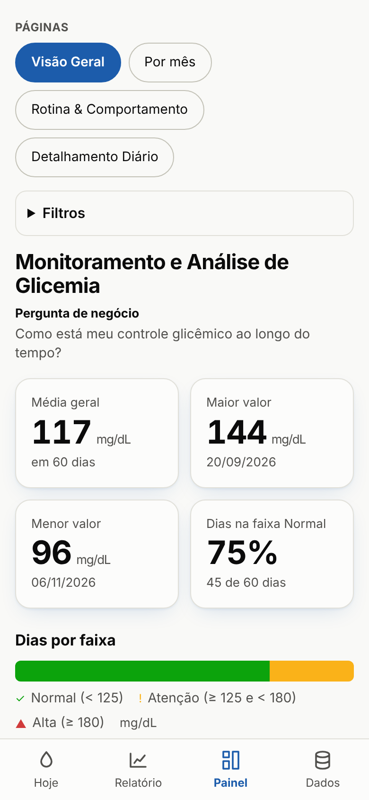
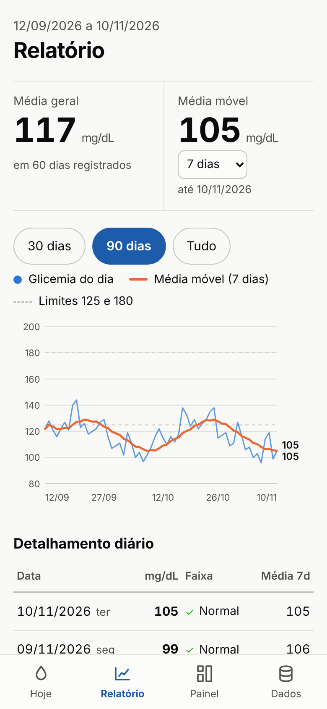

# Glicemia: app de monitoramento

App instalável no celular (PWA) para registrar a glicemia em jejum todos os dias e acompanhar os indicadores na hora. Os dados ficam só no aparelho; a sincronização entre aparelhos é opcional.

  
  

*Telas com dados fictícios de demonstração.*

## O problema

As medições eram anotadas numa planilha. A análise (no [dashboard Power BI](/projetos/monitoramento-glicemia.html)) só acontecia de tempos em tempos, longe do momento em que a decisão é tomada: a refeição do dia.

## O que construí

Levei os indicadores do dashboard para dentro do registro diário:

- **Relatório:** média geral, média móvel de 7, 14 ou 30 dias, gráfico com os limites de 125 e 180 mg/dL e detalhamento diário.
- **Painel:** as mesmas 4 páginas do dashboard (Visão Geral, Por mês, Rotina & Comportamento, Detalhamento Diário), com maior e menor valor, % de dias na faixa normal e comparação fim de semana × dias úteis.
- **Faixas personalizadas** pelo usuário (normal, atenção, alta).
- **Importação** do histórico da planilha via CSV.

## Resultado

O indicador que antes dependia de abrir o Power BI agora aparece a cada medição. Um mesmo modelo de análise atende dois públicos: o dashboard para análise de período, o app para o acompanhamento diário.

## Tecnologias

JavaScript puro, PWA (service worker e manifesto para instalar no celular), armazenamento local e sincronização opcional, publicado no GitHub Pages.

🔗 [Abrir o app](https://opusvix.github.io/glicemia/){:target="_blank" rel="noopener"} · [Código no GitHub](https://github.com/opusvix/glicemia){:target="_blank" rel="noopener"}

[← Voltar ao portfólio](/#projetos){: .back-home}
