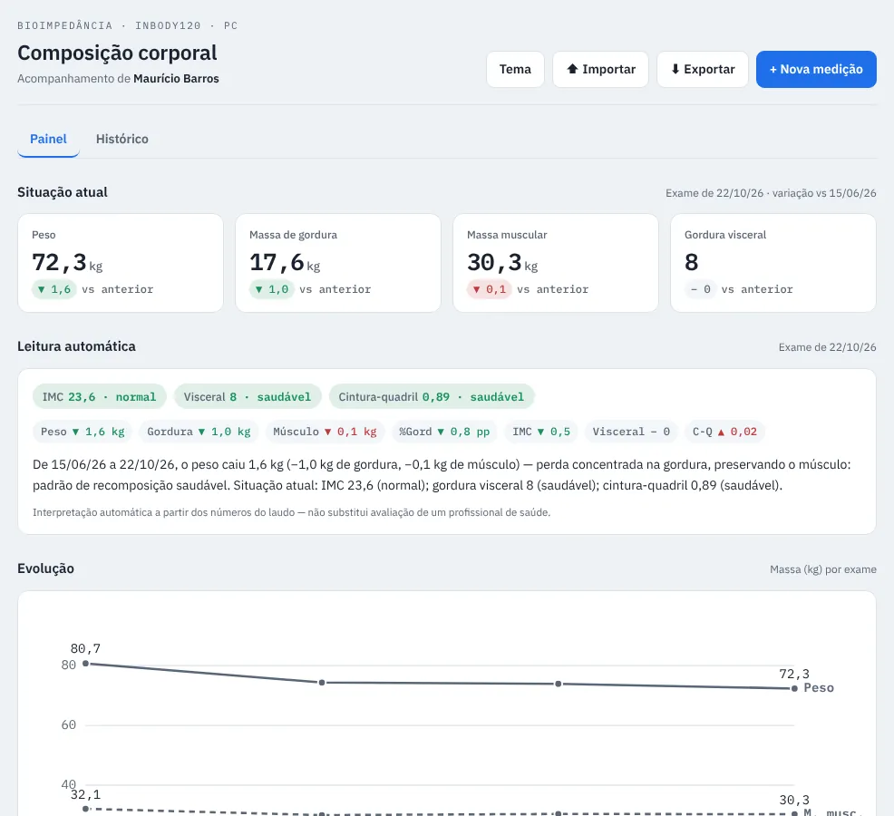

# InBody: composição corporal

App de uma página para acompanhar exames de bioimpedância InBody120 ao longo do tempo, com painel, leitura automática dos indicadores, gráfico de evolução e exportação.

## O problema

Cada laudo InBody120 é uma folha A4 com a foto de um único momento. Com os laudos guardados em PDF, não dá para responder à pergunta que importa: o peso caiu por perda de gordura ou de músculo?

## O que construí

- **Modelo de dados:** cada laudo vira uma linha com 13 medidas (peso, gordura, % de gordura, massa muscular, água, proteína, minerais, massa livre de gordura, taxa metabólica basal, IMC, gordura visceral, cintura-quadril e pontuação).
- **Situação atual:** os 4 indicadores principais do último exame, com a variação contra o anterior.
- **Leitura automática:** classifica IMC, gordura visceral e cintura-quadril contra as faixas de referência e escreve a interpretação da mudança.
- **Evolução e histórico**, com inclusão e edição de medições.
- **Exportação** em JSON, CSV e relatório Markdown.

Uma regra de negócio importante: as faixas de referência do laudo mudam com idade e peso, então o app compara sempre o **valor absoluto** entre exames, nunca a faixa.

## Resultado (4 exames, nov/2025 a out/2026)

| Indicador | 21/11/2025 | 22/10/2026 | Variação |
| --- | --- | --- | --- |
| Peso (kg) | 80,7 | 72,3 | −8,4 |
| Massa de gordura (kg) | 22,8 | 17,6 | −5,2 |
| IMC | 26,4 | 23,6 | de sobrepeso para normal |
| Gordura visceral (nível) | 10 | 8 | volta à faixa ≤ 9 |
| Massa muscular esquelética (kg) | 32,1 | 30,3 | −1,8 |

A série mostra o que um laudo isolado esconde: a perda foi concentrada na gordura, mas a massa muscular caiu entre nov/2025 e fev/2026 e só recuperou parte depois. É o ponto de atenção que o app destaca.

## Tecnologias

HTML, CSS e JavaScript num único arquivo, gráficos em SVG e dados guardados no navegador (`localStorage`), sem servidor.

🔗 [Abrir o app](https://opusvix.github.io/inbody/){:target="_blank" rel="noopener"} · [Código e dados no GitHub](https://github.com/opusvix/inbody){:target="_blank" rel="noopener"}

