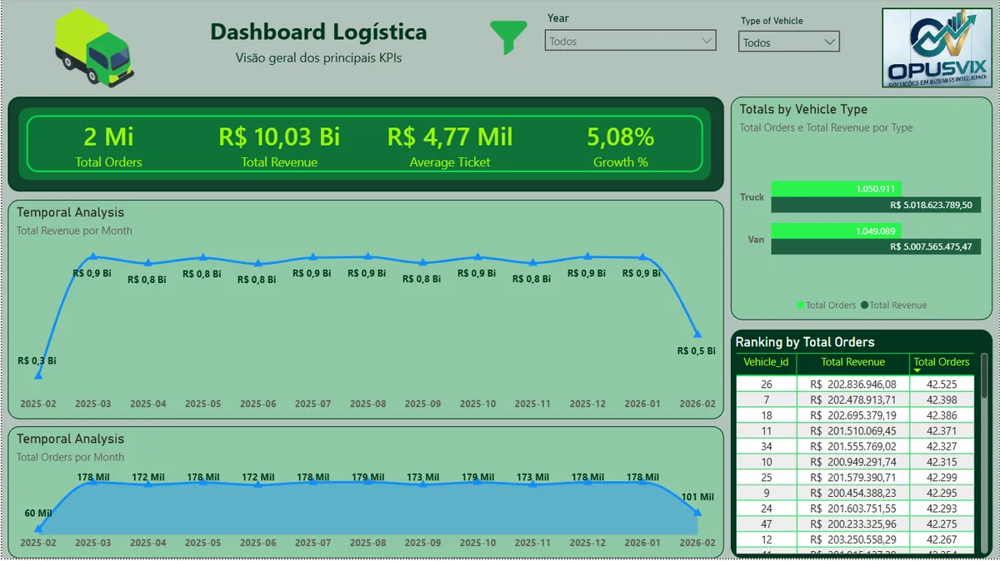
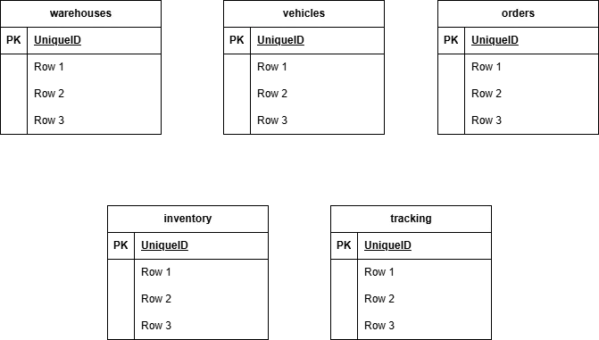

# LogiTrack SQL Analytics

Ambiente logístico simulado com 2,1 milhões de registros em PostgreSQL, focado em otimização de consultas SQL e particionamento de tabelas, com indicadores operacionais no Power BI.

## O problema

Com milhões de pedidos numa única tabela, as consultas de acompanhamento ficam lentas, e o painel operacional demora a responder justamente quando a equipe precisa decidir.

## O que construí

- **Base de dados:** PostgreSQL com 2.100.000 registros de pedidos.
- **Particionamento por data:** as tabelas foram divididas por período, para que a consulta leia só as partições necessárias.
- **Indicadores no Power BI:**

| Métrica | Descrição |
| --- | --- |
| Total Orders | Total de pedidos |
| Orders by Type | Pedidos por tipo de veículo |
| Avg Delivery Time | Tempo médio de entrega |

## Resultado

| Cenário | Tempo da consulta |
| --- | --- |
| Antes (sem partição) | 551 ms |
| Depois (com partição) | 0,034 ms |

## Tecnologias

PostgreSQL, SQL, Power BI e Docker.

🔗 [Código no GitHub](https://github.com/opusvix/logitrack-sql-analytics){:target="_blank" rel="noopener"}
