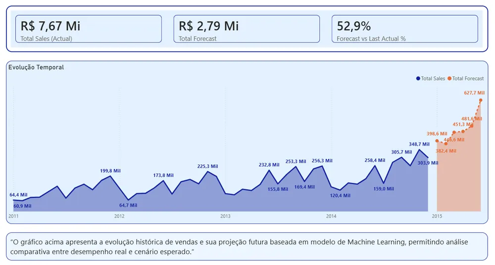
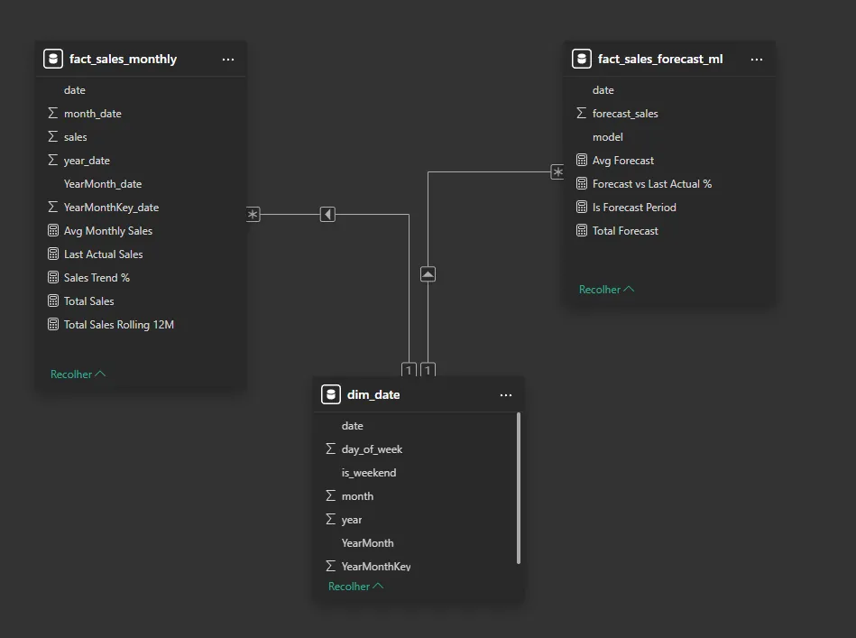

# Previsão de Vendas com Microsoft Fabric

Projeto de ponta a ponta de previsão de vendas no Microsoft Fabric (Lakehouse + Warehouse), com modelagem dimensional em SQL e comparação entre realizado e previsto no Power BI.

{:target="_blank" rel="noopener"}

*Clique na imagem para explorar o dashboard interativo.*

## O problema

Empresas que trabalham com metas comerciais precisam prever as vendas para planejar estoque, definir metas, projetar receita e apoiar decisões estratégicas. O objetivo foi montar uma arquitetura analítica moderna que consolide o histórico, tenha um modelo dimensional confiável e compare o realizado com o previsto.

## O que construí

**Pipeline:** Dataflow Gen2 → Lakehouse → Warehouse → modelagem SQL → Power BI → GitHub Pages

- **Lakehouse:** armazenamento dos dados brutos.
- **Warehouse:** camada estruturada para a modelagem analítica e as regras de negócio.
- **Modelo dimensional em SQL:**
  - `dim_date`: tabela calendário (date, year, month, day_of_week, is_weekend, YearMonth, YearMonthKey).
  - `fact_sales`: date, total_sales e forecast_value, ligada por `fact_sales.date → dim_date.date`.
- **Lógica de previsão em SQL:** agregação mensal, cálculo de média e tendência e projeção para os períodos futuros (`sql/forecast_query.sql`).
- **Medidas DAX:** `Total Sales = SUM(fact_sales[total_sales])` e `Total Forecast = SUM(fact_sales[forecast_value])`.

## Desafios técnicos resolvidos

- Ordenação errada dos meses no eixo do Power BI, resolvida com a chave `YearMonthKey`.
- Integração entre Lakehouse e Warehouse.
- Tratamento de datas para manter a série temporal consistente.

## Resultado

Um dashboard com as linhas de vendas reais, previsão e previsão total, comparadas mês a mês, sobre um modelo que pode crescer para previsões por categoria ou região.

## Tecnologias

Microsoft Fabric (Dataflow Gen2, Lakehouse, Warehouse SQL endpoint), SQL, Power BI (.pbip), DAX, GitHub e GitHub Pages.

🔗 [Dashboard interativo](https://app.powerbi.com/view?r=eyJrIjoiZTRmMTBmYmYtOGE0Ny00MTc3LTk0OGItZTI3YjE2NjdjYmRiIiwidCI6ImRhM2QxODEwLThlN2YtNGM1Yy1hMzE3LTBjY2I3ZWY2MmIzYSJ9){:target="_blank" rel="noopener"} · [Documentação do projeto](https://opusvix.github.io/sales-forecast-powerbi/){:target="_blank" rel="noopener"} · [Código no GitHub](https://github.com/opusvix/sales-forecast-powerbi){:target="_blank" rel="noopener"}
