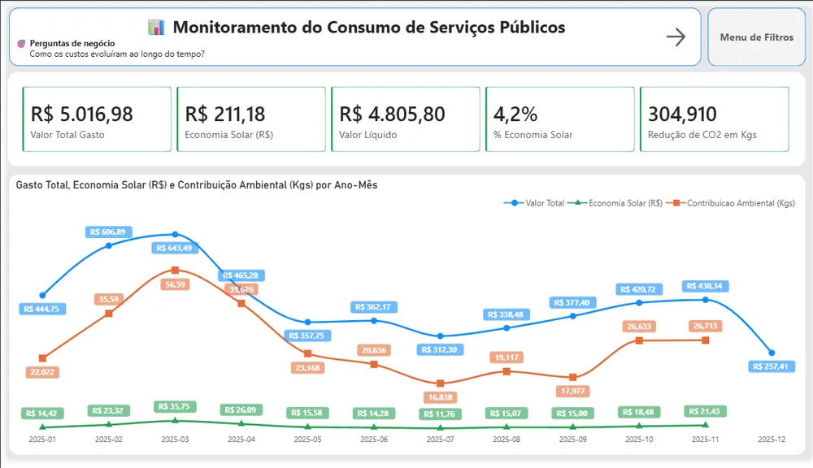
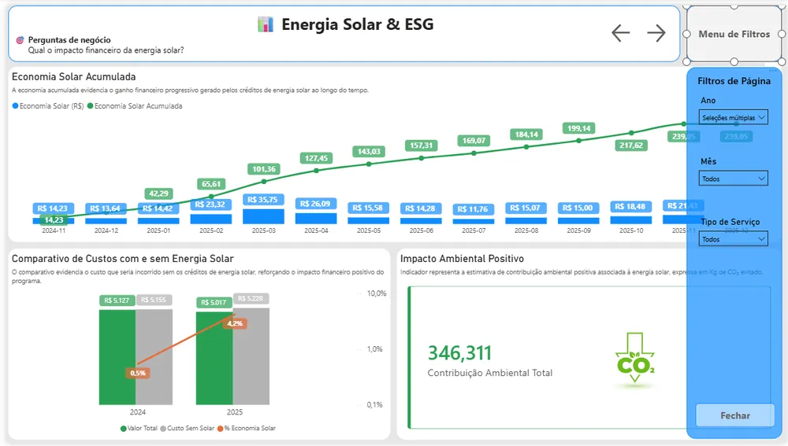

# Serviços Públicos & Energia Solar

Análise no Power BI do histórico de consumo e faturamento de serviços públicos, com foco no impacto financeiro dos créditos de energia solar do programa Solar Digital EDP, obtidos por contrato de locação de usina de minigeração.

## O problema

Com os créditos de energia solar abatidos na conta, não fica claro quanto se economiza de fato, como o consumo varia ao longo do ano e qual é o impacto ambiental.

## O que construí

- **Escopo:** energia elétrica (EDP / Escelsa) e saneamento (CESAN), com comparações mensais e anuais.
- **Modelo em estrela** com tabela calendário dedicada e relacionamentos unidirecionais (calendário → fato).
- **Medidas DAX:** consumo total, valor total, custo bruto, economia solar (R$), custo líquido, economia solar acumulada, % de economia solar e contribuição ambiental (kg de CO₂).
- **4 páginas:** Visão Geral, Consumo & Eficiência (heatmap sazonal), Energia Solar & ESG (com × sem energia solar) e Detalhamento Anual.

## Resultado

Um dashboard mostra quanto os créditos solares economizam por mês e no acumulado, junto com a tendência de consumo e o CO₂ evitado, para apoiar o orçamento da casa e as decisões de eficiência.

## Tecnologias

Power BI Desktop (PBIP / PBIR), Power Query (M), DAX, Git e GitHub, VS Code e OneDrive como fonte de dados.

🔗 [Dashboard interativo](https://app.powerbi.com/view?r=eyJrIjoiN2ExYTQ2NTgtYjRiZS00NTg0LTkxODktN2RlNzU1YTAwYjRiIiwidCI6ImRhM2QxODEwLThlN2YtNGM1Yy1hMzE3LTBjY2I3ZWY2MmIzYSJ9){:target="_blank" rel="noopener"} · [Código no GitHub](https://github.com/opusvix/ServicosPublicos){:target="_blank" rel="noopener"}
