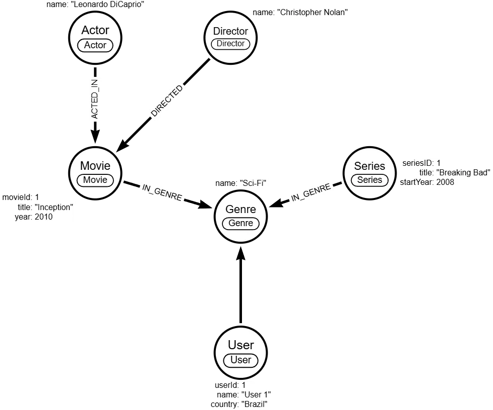

# Banco de grafos para streaming (Neo4j)

Modelo de dados em grafo para um serviço de streaming de filmes e séries, com **Neo4j** e **Cypher**, focado em **relacionamentos** e **sistemas de recomendação**.

## O problema

Recomendações dependem de conexões: usuários com gosto parecido, gêneros, atores e diretores em comum. Num modelo relacional, essas perguntas viram cadeias de joins; num grafo, são um caminho direto pelos relacionamentos.

## O que construí

**Nós:** `User`, `Movie`, `Series`, `Genre`, `Actor`, `Director`.

| Relacionamento | Descrição |
| --- | --- |
| `WATCHED` | Usuário assistiu a um conteúdo (tem `rating`) |
| `ACTED_IN` | Ator atuou num filme ou série |
| `DIRECTED` | Diretor dirigiu um filme ou série |
| `IN_GENRE` | Conteúdo pertence a um gênero |

Exemplo: `(User)-[:WATCHED {rating}]->(Movie | Series)`

**Decisões de modelagem:**

- Filmes e séries são entidades separadas, sem ligação direta; a semelhança é inferida por gêneros, atores e diretores.
- `WATCHED` vale para filmes e séries e guarda a propriedade `rating`.
- Constraints de unicidade (`constraints.cypher`) protegem a integridade do grafo; o script de dados (`graph-data.cypher`) foi gerado a partir do diagrama no Arrows.app.

## Resultado

Um modelo pronto para perguntas como "o que assistiram os usuários com gosto parecido?" e recomendações por gênero, ator ou diretor, com espaço para análise de caminhos e algoritmos como PageRank.

## Tecnologias

Neo4j, Cypher e Arrows.app (modelagem visual de grafos).

🔗 [Código no GitHub](https://github.com/opusvix/streaming-graph-database){:target="_blank" rel="noopener"}
